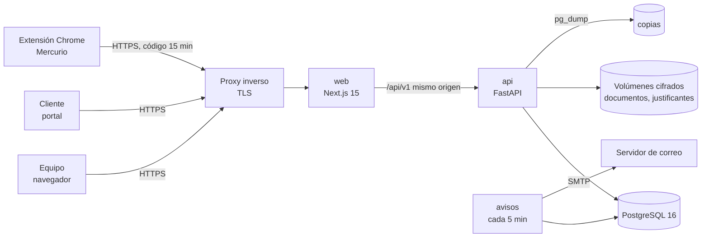
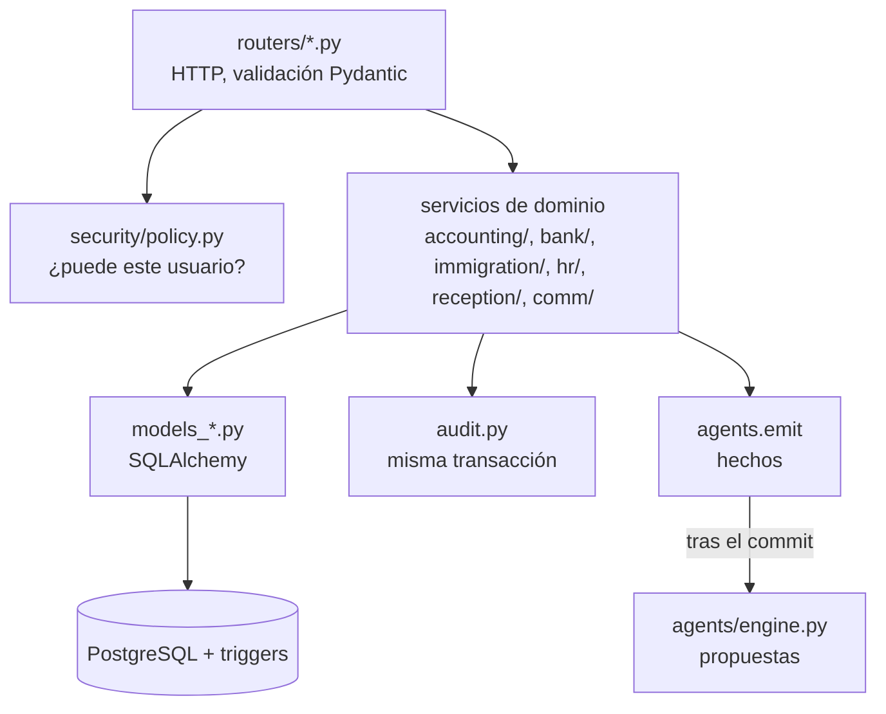
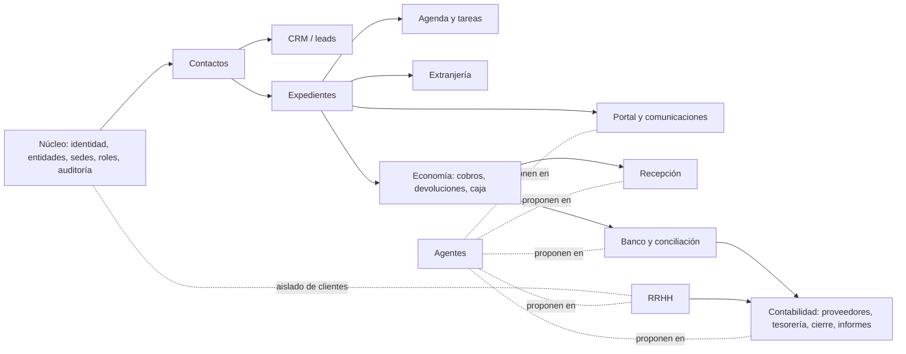

# 02 · Documentación de arquitectura

Sistema Propio · versión F5.6 · 12/11/2026. Decisiones de detalle: `docs/adr/0001…0010`.

## 1. Principio rector: monolito modular
El sistema tiene **una sola API, una sola base de datos PostgreSQL y un único modelo de identidad**, divididos en
módulos con fronteras explícitas: paquetes de código propios, tablas propias y comunicación por servicios internos y
eventos (ADR-0001).

¿Por qué no microservicios? Los permisos se deciden con datos de varios módulos a la vez (entidad, sede, departamento,
asignación). Repartirlos obligaría a replicar la autorización en cada servicio. El equipo es pequeño y el sistema tiene
unas 47 personas usuarias.

Esta decisión **encaja con Odoo**: Odoo también es un monolito modular (un servidor, una base PostgreSQL, módulos
`addons` con dependencias declaradas).

## 2. Vista de contenedores

| Contenedor | Función |
|---|---|
| `web` | Interfaz del equipo y del portal del cliente (Next.js). Reenvía `/api/*` a la API (mismo origen, sin CORS abierto) |
| `api` | Toda la lógica, los permisos, la auditoría, la lectura de documentos (OCR local) y la generación de PDF y SEPA |
| `avisos` | Proceso periódico: ejecuta los agentes programados y envía la cola de correo (`app.ops.agents`, `app.ops.outbox`) |
| `db` | PostgreSQL 16; las reglas críticas se imponen también con triggers |
| Volúmenes | `pgdata`, `documentos`, `justificantes` y la carpeta `copias` |

## 3. Capas dentro de la API

1. **Router**: recibe la petición, valida el esquema y pide el permiso a `policy`.
2. **Política** (`security/policy.py`): decide con entidad, sede, departamento, rol y asignación.
   - Entidad ajena → 404; sin permiso → 403.
   - Ambos se auditan.
3. **Servicio de dominio**: aplica las reglas de negocio.
4. **Auditoría**: el evento se escribe en la misma transacción, con estado anterior y posterior.
5. **Eventos**: `agents.emit()` dentro de la transacción. Los agentes se ejecutan después del commit y solo crean
   propuestas.
6. **Base de datos**: los triggers impiden lo que nunca debe pasar (borrar, reescribir lo cerrado, autofirmarse).

## 4. Mapa de módulos y dependencias

Reglas de dependencia:
- Todos los módulos usan el núcleo para la identidad, la autorización y la auditoría. **Ninguno tiene su propio
  control de acceso.**
- Contactos es la **única fuente** de la persona: el resto la referencia (`contact_id`) y nunca copia sus datos.
- Los datos de RRHH viven en tablas sin relación con clientes.
- Dirección y los informes **solo leen** los registros operativos. No hay hojas paralelas.
- Todo proveedor externo entra por un **adaptador** con cola, reintentos e idempotencia (correo hoy; pasarela,
  WhatsApp, firma y bancos en el futuro).

## 5. Flujos principales
### 5.1 Del contacto al expediente
Contacto (aviso de duplicado, sin fusión automática) → lead con origen obligatorio → cita (pendiente) → ficha →
propuesta de viabilidad → aprobación del letrado → expediente con código consecutivo → tareas y plazos (fecha legal
validada ≠ objetivo interno) → cobros.

### 5.2 Extranjería
1. Se abre el expediente con la versión del catálogo de trámites (cada trámite lleva su fuente oficial).
2. Se suben los documentos, cifrados.
3. La lectura (OCR, MRZ, contrato, padrón, TIE, tasa) **propone** datos; una persona valida.
4. La ficha EX solo admite valores guardados por una persona.
5. Se genera un código de 15 minutos. La extensión de Chrome rellena Mercurio **sin presentar**: no pulsa botones ni
   marca el consentimiento.

### 5.3 Banco → conciliación → cierre
1. Extracto (Norma 43, CAMT.053, CSV, Excel, HTML-xls) → parser determinista.
2. Se guarda el original cifrado. Una reimportación no duplica movimientos.
3. El agente `conciliacion` **propone** coincidencias explicadas. Contabilidad valida, y validar confirma el cobro.
4. Facturas recibidas → remesa → dos firmas de Dirección → fichero SEPA, que una persona sube al banco.
   El cargo conciliado marca la factura como pagada.
5. Cierre del mes: cálculo → revisión → aprobación de Dirección. Después es inmutable, con huella.
6. Rutina de Contabilidad: cada paso se da por hecho solo cuando el sistema lo comprueba. Los informes semanal,
   quincenal y mensual son fotos inmutables.

### 5.4 Agentes (ADR-0010)
| Agente | Se activa con | Propone |
|---|---|---|
| `conciliacion` | `bank.imported` | Coincidencias de movimientos con cobros, facturas y traspasos |
| `mensajes` | `case.opened/closed`, `task.created/changed` | Mensajes al cliente por el portal (plantillas versionadas) |
| `recepcion` | `cash.closed`, `payment.duplicate_override` | Revisión de descuadres y cobros repetidos |
| `rrhh` | `hr.leave.requested` | Avisos de ausencias y documentos |
| `contabilidad` | `treasury.batch.proposed` + diario | Remesas por firmar, cierre del mes, informes por revisar |

Toda propuesta lleva una `dedupe_key` estable (no se repite aunque se rechace) y el permiso con el que se decide.

## 6. Patrones transversales
- **Inmutabilidad**: auditoría encadenada con SHA-256; cierres, informes, justificantes y firmas protegidos por triggers.
- **Versionado en lugar de borrado**: «sustituido», «anulado», versiones de mensajes de 15 minutos.
- **Idempotencia**: extractos (sha256 + `ext_id`), cola de correo, propuestas (`dedupe_key`), documentos (sha256 por
  expediente).
- **Origen de cada dato leído**: documento, lector, versión y quién lo validó.
- **«No disponible aún»**: un módulo sin backend se muestra como pendiente, nunca simulado (ADR-0006).

## 7. Decisiones de arquitectura (ADR)
| ADR | Decisión |
|---|---|
| 0001 | Monolito modular |
| 0002 | Stack: FastAPI, PostgreSQL, Next.js |
| 0003 | Autorización solo en el backend |
| 0004 | Identidad OIDC; modo demo solo en desarrollo |
| 0005 | Auditoría inmutable encadenada |
| 0006 | Módulos pendientes sin simulación |
| 0007 | Acceso local con MFA y sesiones revocables |
| 0008 | Extensión de Mercurio que rellena sin presentar |
| 0009 | Portal propio y conversaciones (sin WhatsApp por ahora, T-31) |
| 0010 | Agentes y bandeja de propuestas |

## 8. Arquitectura destino en Odoo Community
La Dirección ha decidido montar el servidor definitivo sobre **Odoo Community**. Recomendación:
- usar Odoo para lo estándar (contactos, CRM, calendario, facturación y contabilidad básica, RRHH);
- programar **módulos propios** `sp_*` con la lógica específica del despacho;
- usar este sistema como **especificación ejecutable**: sus reglas, pruebas y datos ficticios definen qué debe hacer
  cada módulo.

> **Versión decidida (13/11/2026):** Odoo **20.0 Community** para todo el proyecto, sin Enterprise (ver 18 · AL-01,
> AL-02 y el criterio de 18 §2). Lo que sigue se escribió para 17.0 o 18.0: los módulos de la OCA citados hay que
> comprobarlos en la 20.0 y, si no están, se cubren con desarrollo propio `sp_*` (ver 19 §1.1 y §5).
>
> **Antes de empezar:** compruebe cada módulo en la versión exacta de Odoo que se instale. Varias
> funciones que parecen estándar son de **Enterprise** (de pago) y en Community hay que cubrirlas con módulos de la
> **OCA** (Odoo Community Association) o con desarrollo propio. La tabla indica las conocidas a fecha de hoy.

### 8.1 Correspondencia por módulo
| Módulo de Sistema Propio | Odoo Community estándar | OCA (comunidad) | Desarrollo propio necesario |
|---|---|---|---|
| Entidades, sedes, departamentos | `res.company` (multicompañía), `hr.department` | — | Modelo `sp.branch` y campo sede en los registros |
| Usuarios, roles, permisos | `res.users`, `res.groups`, `ir.model.access`, `ir.rule` | `base_user_role` | Grupos por rol y reglas por sede y asignación (ver 08) |
| 2FA y OIDC | `auth_totp`, `auth_oauth` | `auth_oidc`, `password_security` | Obligar el TOTP a todo usuario interno |
| Auditoría inmutable | Seguimiento `mail.thread` (chatter) | `auditlog` (server-tools) | Cadena SHA-256 y triggers sin UPDATE/DELETE (ver 17) |
| Contactos (persona maestra) | `res.partner` | `partner_identification`, `base_vat` | Identificadores con control (NIE, DNI, pasaporte), aviso de duplicados sin fusión, ficha mínima enmascarada |
| CRM | `crm` | — | Origen obligatorio, embudo propio, Colombia separada |
| Expedientes | `project` (opcional como base) | — | **Módulo `sp_expediente`**: código consecutivo, asignaciones, fases, sin borrado |
| Agenda, tareas, plazos | `calendar`, `mail.activity`, `project.task` | — | Fecha legal validada ≠ objetivo interno; aplazamiento con motivo |
| Extranjería | — | — | **Módulo `sp_extranjeria`**: catálogo versionado de trámites, ficha EX, lectura de documentos, código para la extensión. Mantener la **extensión de Chrome** tal cual |
| Documentos | `ir.attachment` (Documents es Enterprise) | `dms` | Cifrado de archivos, versiones, sin borrado físico |
| Firma | (Sign es Enterprise) | `sign_oca` | Pendiente de decisión (firma cualificada) |
| Portal y comunicaciones | `portal`, `mail` | — | Conversaciones por expediente, avisos urgentes con plantilla; trato de usted |
| WhatsApp / Callbell | (WhatsApp es Enterprise) | — | **Conector propio** con la API de Callbell (T-31) |
| Economía (cobros no fiscales, caja, devoluciones) | `account.payment` | `account_cash_*` | **`sp_recepcion`**: justificante no fiscal, cierre de caja con validador distinto, devoluciones con doble rol |
| Gastos de empresa | `hr_expense` | — | Lectura del ticket con OCR local |
| Banco: extractos | (importación OFX/CAMT es Enterprise) | `account_statement_import_*` (bank-statement-import), `l10n_es_account_statement_import_n43` (l10n-spain) | Formatos Excel de Caixa y BBVA (ya resueltos en `bank/parsers.py`) |
| Conciliación | (widget de conciliación es Enterprise en 17+) | `account_reconcile_oca` | Reglas de propuesta explicadas (`bank/matcher.py`); nunca automática |
| Facturas de proveedores | `account` (Facturación): `account.move` tipo `in_invoice` | `account_invoice_import` (opcional) | Lectura de PDF v2 (`accounting/invoices.py`) como servicio |
| Remesas SEPA con doble firma | — | `account_payment_order`, `account_banking_sepa_credit_transfer`, `account_payment_order_tier_validation` / `base_tier_validation` | Dos firmas de personas distintas, ninguna de quien propone |
| Cierre del mes, rutina, informes | — | `mis_builder` (informes) | **`sp_contabilidad_rutina`**: pasos comprobados, informes inmutables |
| Contabilidad general (asientos, modelos AEAT) | `account`, `l10n_es` | `l10n-spain` (modelos 303, 111, 347…), `account-financial-reporting` | Plan de cuentas de la gestoría (T-40) |
| Facturación a clientes | `account` + `l10n_es_edi_verifactu` (estándar de Odoo 20 Community) | — | Decidido el 13/11/2026 (18 · AL-03): Odoo emite con Verifactu; los `sp_*` no alteran el registro ni el envío (19 §1.3) |
| RRHH | `hr`, `hr_holidays`, `hr_attendance`, `hr_expense` | `payroll` (si hiciera falta) | Salario visible solo con permiso; la nómina se lee, no se calcula (T-50) |
| Agentes | `base_automation`, `ir.cron` | `queue_job` | Modelo `sp.proposal` (bandeja de propuestas con permiso y `dedupe_key`) |
| Correo saliente | `mail` (cola `mail.mail`) | — | Correos sin contenido sensible |
| Copias | Gestor de bases de datos de Odoo | `auto_backup` | Verificación por restauración (ver 13) |

### 8.2 Módulos propios recomendados (`addons/sp_*`)
| Módulo | Depende de | Origen en este código |
|---|---|---|
| `sp_base` | `base`, `mail`, `hr` | `models.py`, `security/`, `audit.py`: sedes, roles, auditoría encadenada, enmascarado |
| `sp_contactos` | `sp_base`, `contacts` | `routers/contacts.py`, `validation.py` |
| `sp_expediente` | `sp_contactos`, `project`, `calendar` | `models_work.py`, `routers/cases.py`, `routers/tasks.py` |
| `sp_extranjeria` | `sp_expediente` | `immigration/`, `routers/immigration*.py`, `apps/extension-mercurio` |
| `sp_portal` | `sp_expediente`, `portal` | `comm/`, `routers/portal.py`, `routers/comm.py` |
| `sp_recepcion` | `sp_expediente`, `account` | `reception/`, `routers/economy.py`, `routers/reception.py` |
| `sp_banco` | `account`, OCA bank-statement-import, `account_reconcile_oca` | `bank/` |
| `sp_contabilidad` | `account`, OCA bank-payment | `accounting/` |
| `sp_rrhh` | `hr`, `hr_holidays` | `hr/` |
| `sp_agentes` | `sp_base`, `base_automation` | `agents/` |
| `sp_lectura` (servicio) | — | `services/receipts.py`, `immigration/reader.py`, `accounting/invoices.py` |

### 8.3 Qué conviene reutilizar sin reescribir
- **Lectura de documentos** (OCR, MRZ, facturas, nóminas, extractos): es Python puro sin dependencia de FastAPI.
  Puede ir dentro de los módulos de Odoo o como un pequeño servicio interno al que Odoo llama.
- **Extensión de Chrome de Mercurio** (`apps/extension-mercurio`): solo hay que cambiar la URL de la que lee la ficha.
- **Mapas de los formularios EX** (`immigration/ex_forms/EXnn.json`).
- **Pruebas**: los casos de `apps/api/tests` describen el comportamiento esperado. Conviene reescribirlos como
  `TransactionCase` de Odoo.
- **Reglas de la base de datos**: los triggers de `alembic/versions/` se pueden crear en el `init()` de cada modelo
  de Odoo.

### 8.4 Riesgos del cambio a Odoo
| Riesgo | Mitigación |
|---|---|
| Se pierde la seguridad por `sudo()` o por reglas mal definidas | Revisar cada `sudo()`, hacer pruebas de acceso por rol (equivalentes a `test_multiempresa_y_ataques.py`) y una auditoría externa |
| Usar módulos Enterprise sin licencia | Lista cerrada de módulos permitidos; comprobar el manifiesto (`license`) |
| La auditoría de Odoo (chatter) se puede editar o borrar | `auditlog` + tabla propia de solo inserción con triggers |
| Datos de clientes en la base de pruebas | Bases separadas y semilla ficticia; nunca copiar la base real a desarrollo |
| Migración de MNP | Importador de expedientes activos con validación y sin fusión automática (pendiente de decisión) |
| Actualizaciones de versión de Odoo | Fijar la versión, módulos OCA en la misma rama y un entorno de pruebas antes de cada actualización |

### 8.5 Migración de datos de la instalación actual
Los datos reales de la instalación local (cuentas bancarias, extractos, facturas, usuarios) se pueden exportar desde
PostgreSQL y cargar en Odoo con scripts de importación. Las reglas:
- los IBAN se descifran solo en el servidor, con `.env.real`;
- los archivos originales se mueven cifrados;
- la auditoría anterior se conserva como registro histórico de solo lectura.
