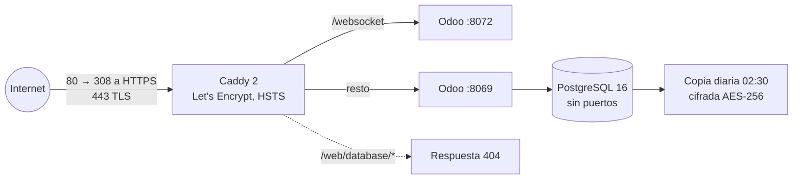
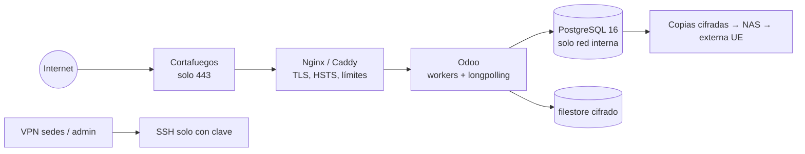

# 03 · Documentación de infraestructura TI

Sistema Propio · versión F5.6 · 12/11/2026 · actualizado el 16/11/2026 (servidor propio con Odoo 20; 11 · DOC-21)

## 1. Situación actual
| Instalación | Dónde | Datos | Uso |
|---|---|---|---|
| Desarrollo | Contenedor de desarrollo (Linux) | Ficticios | Programación y pruebas automáticas |
| Demostración | PC Windows del despacho, Docker Desktop, proyecto `sistemapropio` | Ficticios | Formación y pruebas de uso |
| Real provisional | El mismo PC, proyecto `sistemapropio_real`, `.env.real` | **Reales** | Contabilidad, mientras llega el servidor (T-60) |
| **Preproducción (Odoo 20)** | Servidor propio del despacho, Ubuntu Server 22.04/24.04, carpeta `despliegue/` (§2.1) | **Ficticios**; Verifactu en el entorno de pruebas de la AEAT | Probar con Internet de verdad (AEAT, banco) y practicar. Paquete hecho; **sin probar todavía en el servidor real** (12 · ABI-09) |
| **Servidor definitivo** | Servidor propio del despacho (decidido el 16/11/2026; 18 · AL-17) | Reales | Odoo 20 Community para todo el equipo y todas las sedes. Producción en una base limpia, después de la preproducción (`despliegue/LEEME.md` §9) |

Condiciones de la instalación real provisional (T-60):
- disco cifrado (BitLocker);
- sesión de Windows con contraseña;
- copia diaria con `COPIA_SEGURIDAD_REAL.bat`;
- copia fuera del equipo de la carpeta `copias_real` **y** de `.env.real`, por separado.

Escucha solo en `127.0.0.1`: no es accesible desde la red.

## 2. Topología actual (Docker Compose)
| Servicio | Imagen | Puerto | Volúmenes |
|---|---|---|---|
| `db` | `postgres:16` | interno | `pgdata` |
| `api` | `apps/api/Dockerfile` (Python 3.12, Tesseract, Poppler) | `127.0.0.1:8000` | `documentos`, `justificantes`, `${COPIAS_DIR}` |
| `avisos` | misma imagen que `api` | — | los mismos |
| `web` | `apps/web/Dockerfile` (Node 22, Next.js) | `127.0.0.1:3000` | — |

Al arrancar, la API ejecuta en orden:
1. `alembic upgrade head` (migraciones);
2. `catalog_sync` (roles y permisos);
3. semilla ficticia, **solo** si `APP_ENV=development`;
4. `uvicorn`.

### 2.1 Topología del servidor propio (Odoo 20)
Decidido el 16/11/2026 (18 · AL-17) y hecho en `despliegue/` (11 · DOC-21). Guía: `despliegue/LEEME.md`. Proyecto de
Docker Compose `despacho_<entorno>`; de momento solo existe el entorno `preproduccion` (base `sp_preproduccion`).

| Servicio | Imagen | Puertos | Volúmenes y montajes |
|---|---|---|---|
| `db` | `postgres:16` | **Ninguno** (solo red interna de Docker). Comprobación de salud con `pg_isready` | `db` |
| `odoo` | `despacho/odoo:20` (construida desde `odoo/Dockerfile`) | **Ninguno** al exterior. Dentro de la red interna: 8069 (web) y 8072 (`/websocket`) | `odoo` (almacén de archivos), `odoo/addons`, `odoo/configuracion` y `odoo/pruebas` en solo lectura, `despliegue/odoo.conf` en solo lectura y `despliegue/secretos/` en `/secretos`, en solo lectura |
| `caddy` | `caddy:2` | **80 y 443** | `Caddyfile` en solo lectura, `caddy_data` (certificados) y `caddy_config` |

- **Configuración de Odoo** (`despliegue/odoo.conf.plantilla` → `odoo.conf`, permisos 600): `list_db = False`,
  `dbfilter` y `db_name` de una sola base, `proxy_mode = True`, `http_interface = 0.0.0.0` (solo dentro de la red de
  Docker; 12 · INC-99), `workers` = 2 × núcleos + 1 (máximo 9), `max_cron_threads = 1`, límites de memoria (2 GB
  blando, 2,5 GB duro por proceso) y de tiempo, `without_demo = True`.
- **Secretos** en `despliegue/.env` (permisos 600, generados en el servidor, nunca en el repositorio): contraseña de
  PostgreSQL, contraseña maestra de Odoo (`ADMIN_PASSWD`), clave de cifrado de los IBAN (`SP_CLAVE_CIFRADO`) y clave
  de las copias (`CLAVE_COPIAS`). Custodia: 13 §4.2.
- **Código:** se descarga de GitHub en `/opt/despacho` con una clave de despliegue de **solo lectura**
  (`despliegue/LEEME.md` §2).
- **Zona horaria** del contenedor de Odoo: `Europe/Madrid`.
- **Por revisar (supuesto):** con 8 núcleos salen 9 procesos y cada uno puede llegar a 2,5 GB; hay que ajustar los
  límites a la memoria real del servidor (§3).

## 3. Servidor definitivo: requisitos recomendados
Hay que comprobarlos con las características del servidor comprado.

| Recurso | Mínimo | Recomendado | Por qué |
|---|---|---|---|
| CPU | 4 núcleos | 8 núcleos | Odoo con trabajadores (*workers*) + OCR de documentos |
| RAM | 16 GB | 32 GB | Odoo (≈ 1 GB por cada 6 usuarios concurrentes), PostgreSQL, OCR |
| Disco | 500 GB SSD | 1 TB SSD NVMe en RAID 1 | Documentos de expedientes cifrados; base de datos |
| Copias | Disco o NAS aparte | NAS + copia externa cifrada en la UE | Regla 3-2-1 |
| Sistema | **Ubuntu Server 22.04/24.04 LTS** (decidido el 16/11/2026; 18 · AL-17) | — | Odoo 20 y PostgreSQL van en contenedores Docker; `instalar.sh` instala Docker desde los paquetes de Ubuntu |
| Red | IP fija o DNS dinámico, 100 Mb/s | Fibra simétrica + SAI | Acceso de las sedes y del portal |
| Ubicación | **UE** (T-02, RGPD) | CPD con certificación o local con control de acceso | Datos de clientes, incluidos datos de extranjería |

## 4. Arquitectura de red recomendada

- **Solo el puerto 443** está abierto a Internet.
  - SSH y la administración de la base de datos, solo por VPN (WireGuard) y con clave.
  - PostgreSQL no se expone nunca.
- **TLS** con certificado válido (Let's Encrypt), HSTS, cabeceras de seguridad y `proxy_mode = True` en Odoo.
- **Gestor de bases de datos de Odoo desactivado** en producción: `list_db = False` y `admin_passwd` fuerte.
- **fail2ban** en SSH y en el acceso web; límite de peticiones en el proxy.
- **Separación**: la base de pruebas está en otro servidor o en otra instancia, sin datos reales.
- **Hora** sincronizada (NTP) y zona `Europe/Madrid` para la interfaz; la base de datos guarda en UTC.

### 4.1 Qué está implementado en el servidor propio (16/11/2026)
Con `despliegue/` (11 · DOC-21). Comprobado en un servidor simulado con el dominio `localhost`; **sin probar** en el
servidor real (12 · ABI-09).

| Medida recomendada (§4) | Estado en `despliegue/` |
|---|---|
| TLS con Let's Encrypt | **Hecho:** Caddy obtiene y renueva el certificado solo. Necesita el puerto 80 abierto y el DNS apuntando al servidor |
| HSTS y cabeceras de seguridad | **Hecho:** HSTS (1 año, subdominios), `X-Content-Type-Options: nosniff`, `X-Frame-Options: SAMEORIGIN`, `Referrer-Policy: strict-origin-when-cross-origin`; sin la cabecera `Server` |
| `proxy_mode = True` | **Hecho** |
| Gestor de bases de datos cerrado | **Hecho:** `list_db = False`, `admin_passwd` aleatoria y Caddy responde 404 en `/web/database/*` |
| PostgreSQL sin exponer | **Hecho:** sin puertos publicados. Odoo tampoco publica puertos: el 8069 no es accesible desde fuera (comprobado) |
| Solo el puerto 443 abierto | **Distinto:** también el **80**, que hace falta para el certificado y redirige a HTTPS (308) |
| SSH solo por VPN y con clave | **No hecho:** `instalar.sh` permite SSH en `ufw` desde cualquier origen. La VPN (WireGuard) queda pendiente |
| Cortafuegos | **En parte:** `instalar.sh` añade las reglas de SSH, 80 y 443 en `ufw`, pero **no lo activa** para no cortar el SSH. Se activa a mano (`despliegue/LEEME.md` §4) |
| `fail2ban` y límite de peticiones en el proxy | **No hecho** (12 · ABI-10) |
| Separación de entornos | **En parte:** proyecto y base por entorno (`despacho_<entorno>`, `sp_<entorno>`). La producción aún no se instala; será otra base limpia, en este servidor o en otro |

## 5. Entornos
| Entorno | Datos | Quién entra | Cambios |
|---|---|---|---|
| Desarrollo | Ficticios (semilla) | Programadores | Libres |
| Pruebas / preproducción | Ficticios o anonimizados | Programadores + personas que validan | Se instala cada versión antes de producción |
| Producción | Reales | Equipo del despacho | Solo versiones probadas, con ventana de mantenimiento y copia previa |

## 6. Copias de seguridad
- **Diarias**: base de datos (`pg_dump` en formato personalizado) + archivos (filestore o volúmenes de documentos).
  Se conservan 14 días; además, una copia semanal durante 8 semanas y una mensual durante 12 meses.
- **Verificación**: cada copia se restaura en una base aparte. Se comprueban el esquema y la cadena de auditoría
  (procedimiento implementado en `app/ops/backup.py`; ver 13).
- **Claves**: la clave de cifrado (`FIELD_ENCRYPTION_KEY`, o la equivalente en Odoo) se guarda **separada** de las
  copias, en un gestor de secretos. Sin ella, los datos cifrados no se recuperan.
- **Fuera del servidor**: copia cifrada en otro lugar dentro de la UE.
- **Simulacro de recuperación** cada trimestre.

### 6.1 Copias en el servidor propio (Odoo 20)
Hecho en `despliegue/` (11 · DOC-21). Procedimiento: 13 §4.2.

| Qué | Cómo |
|---|---|
| Cuándo | Cada día a las 02:30 (`/etc/cron.d/odoo-despacho-copias`); registro en `/var/log/odoo-despacho-copias.log` |
| Qué se copia | Base de datos (`pg_dump -Fc`) y almacén de archivos de Odoo (`tar`) |
| Cifrado | `openssl` AES-256-CBC con PBKDF2 (200 000 iteraciones) y la clave `CLAVE_COPIAS`; huellas SHA-256 en un archivo aparte |
| Dónde | `/var/backups/odoo-despacho` (permisos 700), en el **mismo** servidor |
| Rotación | 14 días; las de los domingos, 8 semanas; las del día 1, 12 meses |
| Claves | Ni `SP_CLAVE_CIFRADO` ni `CLAVE_COPIAS` van dentro de la copia. Se guardan aparte con `.env` |
| Verificación | `restaurar.sh` comprueba las huellas y restaura en una base **nueva**. No hay cadena de auditoría que verificar en Odoo 20 todavía. El defecto que movía el almacén de archivos de la base en uso (12 · ABI-11) está **resuelto** desde el 16/11/2026 |
| Fuera del servidor | **Pendiente:** no está automatizado y falta decidir dónde (T-17; 18 · AL-17) |

## 7. Supervisión
- Estado: `GET /api/v1/health` (sistema actual) o `/web/health` (Odoo 17+).
- Disco, memoria, CPU, certificados y resultado de las copias, con avisos por correo.
- Registros con rotación: no deben contener datos personales.

## 8. Puestos de trabajo
- Navegador actual: Chrome o Edge.
- En Extranjería, la **extensión de Chrome de Mercurio** (`apps/extension-mercurio`) se instala desde la carpeta.
- Aplicación de autenticación en el móvil (Google o Microsoft Authenticator) para el código TOTP.
- Disco cifrado y bloqueo de sesión en los equipos que descargan documentos.

## 9. Pendiente de decidir
| Decisión | Tema |
|---|---|
| T-01 | Proveedor de identidad corporativa (OIDC): Microsoft 365, Google Workspace u otro |
| T-02 | Ubicación del servidor en la UE y contrato de encargado del tratamiento |
| T-17 | Destino de la copia externa. En el servidor propio, las copias ya salen cifradas, pero no se llevan fuera (§6.1) |
| AL-17 | Quién custodia `despliegue/.env` (claves de la base, de los IBAN y de las copias) y dónde se guarda su copia |
| — | Probar el despliegue en el servidor real: DNS, puertos 80 y 443 y certificado (12 · ABI-09) |
| — | Probar Verifactu con el certificado en el entorno de pruebas de la AEAT (`despliegue/LEEME.md` §7; 12 · ABI-04 y ABI-05) |
| — | Supervisión y avisos (disco, certificados, resultado de las copias), `fail2ban` y VPN para el SSH (§4.1; 12 · ABI-10) |
| — | Unir la rama de desarrollo a la principal (`despliegue/LEEME.md` §2 paso 4 apunta a la rama de desarrollo) |
| — | Producción: configuración real sin datos ficticios, Verifactu validado con la AEAT y la gestoría, facturación a clientes y migración (`despliegue/LEEME.md` §9) |
| T-33 | Servidor de correo saliente (SMTP) del despacho |
