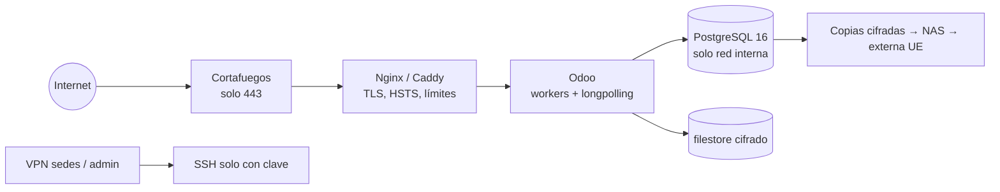

# 03 · Documentación de infraestructura TI

Sistema Propio · versión F5.6 · 12/11/2026

## 1. Situación actual
| Instalación | Dónde | Datos | Uso |
|---|---|---|---|
| Desarrollo | Contenedor de desarrollo (Linux) | Ficticios | Programación y pruebas automáticas |
| Demostración | PC Windows del despacho, Docker Desktop, proyecto `sistemapropio` | Ficticios | Formación y pruebas de uso |
| Real provisional | El mismo PC, proyecto `sistemapropio_real`, `.env.real` | **Reales** | Contabilidad, mientras llega el servidor (T-60) |
| **Servidor definitivo** | Servidor comprado por la empresa | Reales | Odoo Community para todo el equipo y todas las sedes |

Condiciones de la instalación real provisional (T-60):
- disco cifrado (BitLocker);
- sesión de Windows con contraseña;
- copia diaria con `COPIA_SEGURIDAD_REAL.bat`;
- copia fuera del equipo de la carpeta `copias_real` **y** de `.env.real`, por separado.

Escucha solo en `127.0.0.1`: no es accesible desde la red.

## 2. Topología actual (Docker Compose)
| Servicio | Imagen | Puerto | Volúmenes |
|---|---|---|---|
| `db` | `postgres:16` | interno | `pgdata` |
| `api` | `apps/api/Dockerfile` (Python 3.12, Tesseract, Poppler) | `127.0.0.1:8000` | `documentos`, `justificantes`, `${COPIAS_DIR}` |
| `avisos` | misma imagen que `api` | — | los mismos |
| `web` | `apps/web/Dockerfile` (Node 22, Next.js) | `127.0.0.1:3000` | — |

Al arrancar, la API ejecuta en orden:
1. `alembic upgrade head` (migraciones);
2. `catalog_sync` (roles y permisos);
3. semilla ficticia, **solo** si `APP_ENV=development`;
4. `uvicorn`.

## 3. Servidor definitivo: requisitos recomendados
Hay que comprobarlos con las características del servidor comprado.

| Recurso | Mínimo | Recomendado | Por qué |
|---|---|---|---|
| CPU | 4 núcleos | 8 núcleos | Odoo con trabajadores (*workers*) + OCR de documentos |
| RAM | 16 GB | 32 GB | Odoo (≈ 1 GB por cada 6 usuarios concurrentes), PostgreSQL, OCR |
| Disco | 500 GB SSD | 1 TB SSD NVMe en RAID 1 | Documentos de expedientes cifrados; base de datos |
| Copias | Disco o NAS aparte | NAS + copia externa cifrada en la UE | Regla 3-2-1 |
| Sistema | Ubuntu Server 22.04/24.04 LTS o Debian 12 | — | Soportados por Odoo 17/18 |
| Red | IP fija o DNS dinámico, 100 Mb/s | Fibra simétrica + SAI | Acceso de las sedes y del portal |
| Ubicación | **UE** (T-02, RGPD) | CPD con certificación o local con control de acceso | Datos de clientes, incluidos datos de extranjería |

## 4. Arquitectura de red recomendada

- **Solo el puerto 443** está abierto a Internet.
  - SSH y la administración de la base de datos, solo por VPN (WireGuard) y con clave.
  - PostgreSQL no se expone nunca.
- **TLS** con certificado válido (Let's Encrypt), HSTS, cabeceras de seguridad y `proxy_mode = True` en Odoo.
- **Gestor de bases de datos de Odoo desactivado** en producción: `list_db = False` y `admin_passwd` fuerte.
- **fail2ban** en SSH y en el acceso web; límite de peticiones en el proxy.
- **Separación**: la base de pruebas está en otro servidor o en otra instancia, sin datos reales.
- **Hora** sincronizada (NTP) y zona `Europe/Madrid` para la interfaz; la base de datos guarda en UTC.

## 5. Entornos
| Entorno | Datos | Quién entra | Cambios |
|---|---|---|---|
| Desarrollo | Ficticios (semilla) | Programadores | Libres |
| Pruebas / preproducción | Ficticios o anonimizados | Programadores + personas que validan | Se instala cada versión antes de producción |
| Producción | Reales | Equipo del despacho | Solo versiones probadas, con ventana de mantenimiento y copia previa |

## 6. Copias de seguridad
- **Diarias**: base de datos (`pg_dump` en formato personalizado) + archivos (filestore o volúmenes de documentos).
  Se conservan 14 días; además, una copia semanal durante 8 semanas y una mensual durante 12 meses.
- **Verificación**: cada copia se restaura en una base aparte. Se comprueban el esquema y la cadena de auditoría
  (procedimiento implementado en `app/ops/backup.py`; ver 13).
- **Claves**: la clave de cifrado (`FIELD_ENCRYPTION_KEY`, o la equivalente en Odoo) se guarda **separada** de las
  copias, en un gestor de secretos. Sin ella, los datos cifrados no se recuperan.
- **Fuera del servidor**: copia cifrada en otro lugar dentro de la UE.
- **Simulacro de recuperación** cada trimestre.

## 7. Supervisión
- Estado: `GET /api/v1/health` (sistema actual) o `/web/health` (Odoo 17+).
- Disco, memoria, CPU, certificados y resultado de las copias, con avisos por correo.
- Registros con rotación: no deben contener datos personales.

## 8. Puestos de trabajo
- Navegador actual: Chrome o Edge.
- En Extranjería, la **extensión de Chrome de Mercurio** (`apps/extension-mercurio`) se instala desde la carpeta.
- Aplicación de autenticación en el móvil (Google o Microsoft Authenticator) para el código TOTP.
- Disco cifrado y bloqueo de sesión en los equipos que descargan documentos.

## 9. Pendiente de decidir
| Decisión | Tema |
|---|---|
| T-01 | Proveedor de identidad corporativa (OIDC): Microsoft 365, Google Workspace u otro |
| T-02 | Ubicación del servidor en la UE y contrato de encargado del tratamiento |
| T-17 | Destino de la copia externa |
| T-33 | Servidor de correo saliente (SMTP) del despacho |
