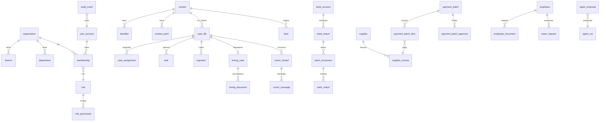

# 07 · Documentación de base de datos

Base de datos única **PostgreSQL 16**, gestionada con **Alembic** (12 migraciones, `apps/api/alembic/versions/0001…0012`). 78 tablas. Este documento se genera a partir de los modelos SQLAlchemy y de las migraciones, así que refleja el código entregado.

## Convenciones

- Claves primarias UUID (`id`), creadas por la aplicación.
- Toda tabla de negocio lleva `organization_id`: es la frontera entre entidades (España / Colombia).
- Importes en **céntimos enteros** (`*_cents`), con signo en banco y caja. Nunca decimales en coma flotante.
- Fechas y horas en **UTC** (`timestamptz`). La interfaz las muestra en Europe/Madrid.
- **Sin borrado físico** de lo que tiene valor de prueba: triggers `*_no_delete`, tablas de solo inserción y estados `anulado` / `sustituido` en lugar de DELETE.
- Datos sensibles **cifrados en columna** (Fernet, clave `FIELD_ENCRYPTION_KEY`): secretos TOTP, textos de mensajes, IBAN completos, números de documento del personal. Los archivos (justificantes, documentos, extractos) se guardan cifrados en volúmenes, nunca en la base.
- Las migraciones solo añaden y son reversibles; las pruebas hacen subida → bajada → subida.

## Diagrama de relaciones principales

## Reglas que impone la propia base de datos

| Migración | Trigger o restricción | Qué impide |
|---|---|---|
| 0001 | `audit_event_no_update` (BEFORE UPDATE OR DELETE en `audit_event`) | modificar un evento de auditoría |
| 0001 | `audit_event_no_truncate` (BEFORE TRUNCATE en `audit_event`) | vaciar la auditoría |
| 0001 | `case_file_no_delete` (BEFORE DELETE en `case_file`) | borrar expedientes |
| 0001 | `contact_no_delete` (BEFORE DELETE en `contact`) | borrar contactos |
| 0001 | `case_file_same_org` (BEFORE INSERT OR UPDATE en `case_file`) | expediente con cliente de otra entidad |
| 0002 | `lead_same_org` (BEFORE INSERT OR UPDATE en `lead`) | lead de otra entidad |
| 0002 | `task_same_org` (BEFORE INSERT OR UPDATE en `task`) | tarea con expediente de otra entidad |
| 0002 | `{tabla}_no_delete` (BEFORE DELETE en `(varias)`) | borrar filas (aplicado a las tablas de agentes, banco, comunicaciones, RRHH y contabilidad) |
| 0003 | `backup_run_append_only` (BEFORE UPDATE OR DELETE en `backup_run`) | cambiar el registro de copias |
| 0005 | `immig_stage_event_append_only` (BEFORE UPDATE OR DELETE en `immig_stage_event`) | cambiar el historial de fases de extranjería |
| 0006 | `immig_form_no_delete` (BEFORE DELETE en `immig_form`) | borrar fichas EX |
| 0009 | `cash_closing_guard` (BEFORE UPDATE OR DELETE en `cash_closing`) | cambiar un cierre de caja salvo validarlo una vez, por otra persona |
| 0009 | `payment_receipt_no_delete` (BEFORE DELETE OR UPDATE en `payment_receipt`) | borrar justificantes (son inmutables) |
| 0009 | `payment_receipt_same_org` (BEFORE INSERT en `payment_receipt`) | justificante de otra entidad |
| 0009 | `cash_closing_append_only` (BEFORE UPDATE OR DELETE en `cash_closing`) | (sustituido por cash_closing_guard) |
| 0011 | `payment_batch_approval_no_update` (BEFORE UPDATE en `payment_batch_approval`) | cambiar una firma |
| 0011 | `payment_batch_item_no_update` (BEFORE UPDATE en `payment_batch_item`) | cambiar las líneas de una remesa |
| 0011 | `month_close_guard` (BEFORE UPDATE en `month_close`) | cambiar un cierre aprobado o sustituido, o sus cifras |
| 0011 | `payment_batch_approval_check` (BEFORE INSERT en `payment_batch_approval`) | que firme quien propuso la remesa o alguien de otra entidad |
| 0011 | `supplier_invoice_same_org` (BEFORE INSERT OR UPDATE en `supplier_invoice`) | factura con proveedor de otra entidad |
| 0011 | `payment_batch_item_same_org` (BEFORE INSERT en `payment_batch_item`) | remesa con facturas de otra entidad |
| 0012 | `accounting_routine_item_guard` (BEFORE UPDATE en `accounting_routine_item`) | reabrir o reescribir un paso de la rutina ya cerrado |
| 0012 | `accounting_report_guard` (BEFORE UPDATE en `accounting_report`) | cambiar un informe generado (solo se anota la revisión, una vez) |
| 0011 | `ck_invoice_total` | que el total de una factura no sea base + IVA − retención |
| 0009 | `payment.case_id` nulo solo si `kind='consulta'` | cobros sin expediente que no sean consultas |
| 0009 | validador ≠ quien contó la caja | autovalidar un cierre de caja |
| 0012 | `ck_routine_status` | `status IN ('pendiente','hecho','no_aplica')` |
| 0012 | `ck_routine_cadence` | `cadence IN ('diaria','semanal','quincenal','mensual')` |
| 0012 | `ck_routine_na_reason` | `status <> 'no_aplica' OR (na_by IS NOT NULL AND length(na_reason) >= 10)` |
| 0012 | `ck_report_kind` | `kind IN ('semanal','quincenal','mensual')` |
| 0012 | `ck_report_period` | `period_to >= period_from` |

## Tablas por módulo

Para cada tabla: columnas (tipo, nulo, clave foránea), claves únicas e índices. La columna «Odoo Community» de cada módulo indica dónde encaja al migrar (ver también 02 · Arquitectura).

### Núcleo: entidades, sedes, personas, contactos, expedientes y auditoría

Archivo `apps/api/app/models.py` · migraciones 0001 · **Odoo Community:** res.company / res.partner / res.users / res.groups; expedientes: módulo propio `sp_expediente`; auditoría: OCA `auditlog` + reglas propias

#### `access_grant`

Autorización puntual, justificada y con caducidad (p. ej. acceso a un expediente concreto).

| Columna | Tipo | Nulo | Referencia |
|---|---|---|---|
| `id` (PK) | UUID | no |  |
| `user_id` | UUID | no | user_account.id |
| `organization_id` | UUID | no | organization.id |
| `resource_type` | VARCHAR(40) | no |  |
| `resource_id` | UUID | no |  |
| `permission` | VARCHAR(80) | no |  |
| `reason` | TEXT | no |  |
| `granted_by` | UUID | no | user_account.id |
| `created_at` | DATETIME | no |  |
| `expires_at` | DATETIME | no |  |
| `revoked_at` | DATETIME | sí |  |
| `revoked_by` | UUID | sí | user_account.id |

Índices: (user_id)

#### `address`

| Columna | Tipo | Nulo | Referencia |
|---|---|---|---|
| `id` (PK) | UUID | no |  |
| `contact_id` | UUID | no | contact.id |
| `kind` | VARCHAR(20) | no |  |
| `line1` | VARCHAR(200) | no |  |
| `line2` | VARCHAR(200) | sí |  |
| `postal_code` | VARCHAR(12) | sí |  |
| `municipality` | VARCHAR(120) | no |  |
| `province` | VARCHAR(120) | sí |  |
| `country` | VARCHAR(2) | no |  |
| `valid_from` | DATE | sí |  |
| `valid_to` | DATE | sí |  |
| `created_at` | DATETIME | no |  |

Índices: (contact_id)

#### `audit_event`

Bitácora encadenada por hash. UPDATE/DELETE/TRUNCATE bloqueados por trigger en BD.

| Columna | Tipo | Nulo | Referencia |
|---|---|---|---|
| `id` (PK) | BIGINT | no |  |
| `occurred_at` | DATETIME | no |  |
| `actor_user_id` | UUID | sí |  |
| `organization_id` | UUID | sí |  |
| `action` | VARCHAR(80) | no |  |
| `resource_type` | VARCHAR(40) | no |  |
| `resource_id` | VARCHAR(80) | sí |  |
| `outcome` | VARCHAR(10) | no |  |
| `reason` | TEXT | sí |  |
| `before` | JSONB | sí |  |
| `after` | JSONB | sí |  |
| `ip` | VARCHAR(64) | sí |  |
| `request_id` | VARCHAR(64) | sí |  |
| `prev_hash` | VARCHAR(64) | no |  |
| `hash` | VARCHAR(64) | no |  |

Únicas: (hash)

Índices: (action); (resource_type, resource_id)

#### `branch`

| Columna | Tipo | Nulo | Referencia |
|---|---|---|---|
| `id` (PK) | UUID | no |  |
| `organization_id` | UUID | no | organization.id |
| `name` | VARCHAR(120) | no |  |
| `city` | VARCHAR(120) | no |  |
| `country` | VARCHAR(2) | no |  |
| `timezone` | VARCHAR(60) | no |  |
| `kind` | VARCHAR(20) | no |  |
| `created_at` | DATETIME | no |  |

Índices: (organization_id)

#### `case_assignment`

| Columna | Tipo | Nulo | Referencia |
|---|---|---|---|
| `id` (PK) | UUID | no |  |
| `case_id` | UUID | no | case_file.id |
| `user_id` | UUID | no | user_account.id |
| `role_in_case` | VARCHAR(30) | no |  |
| `start_at` | DATETIME | no |  |
| `end_at` | DATETIME | sí |  |

Índices: (case_id); (user_id)

#### `case_code_counter`

Numeración consecutiva sin reutilización (Q-6.2).

| Columna | Tipo | Nulo | Referencia |
|---|---|---|---|
| `organization_id` (PK) | UUID | no | organization.id |
| `prefix` (PK) | VARCHAR(10) | no |  |
| `year` (PK) | INTEGER | no |  |
| `last_value` | INTEGER | no |  |

#### `case_file`

| Columna | Tipo | Nulo | Referencia |
|---|---|---|---|
| `id` (PK) | UUID | no |  |
| `organization_id` | UUID | no | organization.id |
| `branch_id` | UUID | no | branch.id |
| `department_id` | UUID | no | department.id |
| `contact_id` | UUID | no | contact.id |
| `code` | VARCHAR(30) | no |  |
| `materia` | VARCHAR(20) | no |  |
| `title` | VARCHAR(200) | no |  |
| `status` | VARCHAR(20) | no |  |
| `confidential_summary` | TEXT | no |  |
| `created_by` | UUID | no | user_account.id |
| `created_at` | DATETIME | no |  |
| `updated_at` | DATETIME | no |  |
| `last_activity_at` | DATETIME | no |  |
| `engagement_confirmed_at` | DATETIME | sí |  |
| `engagement_confirmed_by` | UUID | sí | user_account.id |

Únicas: (organization_id, code)

Índices: (organization_id); (contact_id); (department_id)

#### `consent`

Registro de consentimientos/bases jurídicas. Catálogo de finalidades pendiente del DPO.

| Columna | Tipo | Nulo | Referencia |
|---|---|---|---|
| `id` (PK) | UUID | no |  |
| `contact_id` | UUID | no | contact.id |
| `purpose` | VARCHAR(60) | no |  |
| `granted` | BOOLEAN | no |  |
| `source` | VARCHAR(60) | no |  |
| `recorded_by` | UUID | no | user_account.id |
| `recorded_at` | DATETIME | no |  |
| `revoked_at` | DATETIME | sí |  |

Índices: (contact_id)

#### `contact`

Contacto maestro: una persona, N expedientes. Nunca se fusiona automáticamente.

| Columna | Tipo | Nulo | Referencia |
|---|---|---|---|
| `id` (PK) | UUID | no |  |
| `organization_id` | UUID | no | organization.id |
| `primary_branch_id` | UUID | sí | branch.id |
| `given_name` | VARCHAR(120) | no |  |
| `family_names` | VARCHAR(200) | no |  |
| `search_name` | VARCHAR(400) | no |  |
| `birth_date` | DATE | sí |  |
| `nationality` | VARCHAR(2) | sí |  |
| `preferred_language` | VARCHAR(5) | no |  |
| `origin` | VARCHAR(60) | sí |  |
| `status` | VARCHAR(20) | no |  |
| `is_synthetic` | BOOLEAN | no |  |
| `possible_duplicate` | BOOLEAN | no |  |
| `version` | INTEGER | no |  |
| `created_by` | UUID | no | user_account.id |
| `created_at` | DATETIME | no |  |
| `updated_at` | DATETIME | no |  |

Índices: (organization_id); (search_name)

#### `contact_point`

Teléfonos y correos. Un teléfono puede compartirse entre personas: sin restricción única.

| Columna | Tipo | Nulo | Referencia |
|---|---|---|---|
| `id` (PK) | UUID | no |  |
| `contact_id` | UUID | no | contact.id |
| `kind` | VARCHAR(10) | no |  |
| `value_normalized` | VARCHAR(200) | no |  |
| `label` | VARCHAR(40) | sí |  |
| `is_primary` | BOOLEAN | no |  |
| `created_at` | DATETIME | no |  |

Índices: (kind, value_normalized); (contact_id)

#### `department`

| Columna | Tipo | Nulo | Referencia |
|---|---|---|---|
| `id` (PK) | UUID | no |  |
| `organization_id` | UUID | no | organization.id |
| `code` | VARCHAR(10) | no |  |
| `name` | VARCHAR(120) | no |  |
| `is_legal` | BOOLEAN | no |  |
| `created_at` | DATETIME | no |  |

Únicas: (organization_id, code)

Índices: (organization_id)

#### `duplicate_review`

Cola de revisión humana de posibles duplicados (AT-04). Nunca fusiona.

| Columna | Tipo | Nulo | Referencia |
|---|---|---|---|
| `id` (PK) | UUID | no |  |
| `organization_id` | UUID | no | organization.id |
| `contact_id` | UUID | no | contact.id |
| `candidate_contact_id` | UUID | no | contact.id |
| `reason` | VARCHAR(40) | no |  |
| `justification` | TEXT | no |  |
| `status` | VARCHAR(20) | no |  |
| `created_by` | UUID | no | user_account.id |
| `created_at` | DATETIME | no |  |

#### `identifier`

| Columna | Tipo | Nulo | Referencia |
|---|---|---|---|
| `id` (PK) | UUID | no |  |
| `contact_id` | UUID | no | contact.id |
| `organization_id` | UUID | no | organization.id |
| `kind` | VARCHAR(20) | no |  |
| `number_normalized` | VARCHAR(40) | no |  |
| `country` | VARCHAR(2) | no |  |
| `valid_until` | DATE | sí |  |
| `created_at` | DATETIME | no |  |

Índices: (organization_id, number_normalized); (contact_id)

#### `membership`

Pertenencia de un usuario a una entidad legal, opcionalmente acotada a sede y departamento.

| Columna | Tipo | Nulo | Referencia |
|---|---|---|---|
| `id` (PK) | UUID | no |  |
| `user_id` | UUID | no | user_account.id |
| `organization_id` | UUID | no | organization.id |
| `branch_id` | UUID | sí | branch.id |
| `department_id` | UUID | sí | department.id |
| `role_id` | UUID | no | role.id |
| `valid_from` | DATETIME | no |  |
| `valid_to` | DATETIME | sí |  |
| `status` | VARCHAR(20) | no |  |

Índices: (user_id); (organization_id)

#### `organization`

| Columna | Tipo | Nulo | Referencia |
|---|---|---|---|
| `id` (PK) | UUID | no |  |
| `name` | VARCHAR(200) | no |  |
| `country` | VARCHAR(2) | no |  |
| `currency` | VARCHAR(3) | no |  |
| `status` | VARCHAR(20) | no |  |
| `created_at` | DATETIME | no |  |

#### `role`

| Columna | Tipo | Nulo | Referencia |
|---|---|---|---|
| `id` (PK) | UUID | no |  |
| `code` | VARCHAR(60) | no |  |
| `name` | VARCHAR(120) | no |  |
| `description` | TEXT | no |  |

Únicas: (code)

#### `role_permission`

| Columna | Tipo | Nulo | Referencia |
|---|---|---|---|
| `role_id` (PK) | UUID | no | role.id |
| `permission` (PK) | VARCHAR(80) | no |  |

#### `user_account`

| Columna | Tipo | Nulo | Referencia |
|---|---|---|---|
| `id` (PK) | UUID | no |  |
| `username` | VARCHAR(80) | no |  |
| `full_name` | VARCHAR(200) | no |  |
| `email` | VARCHAR(200) | no |  |
| `status` | VARCHAR(20) | no |  |
| `external_subject` | VARCHAR(255) | sí |  |
| `is_demo` | BOOLEAN | no |  |
| `created_at` | DATETIME | no |  |
| `password_hash` | VARCHAR(255) | sí |  |
| `password_changed_at` | DATETIME | sí |  |
| `must_change_password` | BOOLEAN | no |  |
| `totp_secret_enc` | TEXT | sí |  |
| `totp_confirmed_at` | DATETIME | sí |  |
| `totp_last_step` | BIGINT | sí |  |
| `last_login_at` | DATETIME | sí |  |
| `created_by` | UUID | sí | user_account.id |

Únicas: (username); (external_subject)

### Acceso seguro y copias

Archivo `apps/api/app/models_security.py` · migraciones 0003 · **Odoo Community:** auth_totp (2FA, Community), sesiones de Odoo; copias: pg_dump + filestore

#### `auth_attempt`

Intentos de acceso (contraseña o código) para limitar ataques de fuerza bruta.

| Columna | Tipo | Nulo | Referencia |
|---|---|---|---|
| `id` (PK) | BIGINT | no |  |
| `at` | DATETIME | no |  |
| `username` | VARCHAR(80) | no |  |
| `ip` | VARCHAR(64) | sí |  |
| `kind` | VARCHAR(20) | no |  |
| `success` | BOOLEAN | no |  |

Índices: (username, at); (ip, at)

#### `backup_run`

Cada copia y su comprobación de restauración (AT-29). Solo se añade; nunca se modifica.

| Columna | Tipo | Nulo | Referencia |
|---|---|---|---|
| `id` (PK) | UUID | no |  |
| `created_at` | DATETIME | no |  |
| `file_name` | VARCHAR(200) | no |  |
| `size_bytes` | BIGINT | sí |  |
| `sha256` | VARCHAR(64) | sí |  |
| `schema_version` | VARCHAR(40) | sí |  |
| `restore_ok` | BOOLEAN | no |  |
| `audit_chain_ok` | BOOLEAN | sí |  |
| `audit_events` | INTEGER | sí |  |
| `matches_live_chain` | BOOLEAN | sí |  |
| `table_counts` | JSONB | sí |  |
| `detail` | TEXT | sí |  |
| `triggered_by` | VARCHAR(80) | no |  |

#### `user_session`

Cada inicio de sesión. El token de la cookie solo es válido mientras esta fila siga vigente.

| Columna | Tipo | Nulo | Referencia |
|---|---|---|---|
| `id` (PK) | UUID | no |  |
| `user_id` | UUID | no | user_account.id |
| `auth_method` | VARCHAR(20) | no |  |
| `created_at` | DATETIME | no |  |
| `last_seen_at` | DATETIME | no |  |
| `expires_at` | DATETIME | no |  |
| `revoked_at` | DATETIME | sí |  |
| `revoked_by` | UUID | sí | user_account.id |
| `revoke_reason` | VARCHAR(200) | sí |  |
| `ip` | VARCHAR(64) | sí |  |
| `user_agent` | VARCHAR(200) | sí |  |

Índices: (user_id)

### CRM, fases del expediente, tareas y agenda

Archivo `apps/api/app/models_work.py` · migraciones 0002 · **Odoo Community:** crm.lead (CRM), project.task / mail.activity / calendar.event

#### `case_phase_event`

| Columna | Tipo | Nulo | Referencia |
|---|---|---|---|
| `id` (PK) | UUID | no |  |
| `case_id` | UUID | no | case_file.id |
| `actor_user_id` | UUID | no | user_account.id |
| `from_status` | VARCHAR(20) | sí |  |
| `to_status` | VARCHAR(20) | no |  |
| `note` | TEXT | sí |  |
| `occurred_at` | DATETIME | no |  |

Índices: (case_id)

#### `case_relation`

| Columna | Tipo | Nulo | Referencia |
|---|---|---|---|
| `id` (PK) | UUID | no |  |
| `case_id` | UUID | no | case_file.id |
| `related_case_id` | UUID | no | case_file.id |
| `kind` | VARCHAR(30) | no |  |
| `note` | TEXT | sí |  |
| `created_by` | UUID | no | user_account.id |
| `created_at` | DATETIME | no |  |

Únicas: (case_id, related_case_id)

Índices: (case_id); (related_case_id)

#### `lead`

| Columna | Tipo | Nulo | Referencia |
|---|---|---|---|
| `id` (PK) | UUID | no |  |
| `organization_id` | UUID | no | organization.id |
| `branch_id` | UUID | sí | branch.id |
| `contact_id` | UUID | no | contact.id |
| `origin_code` | VARCHAR(40) | no | lead_origin.code |
| `campaign` | VARCHAR(120) | sí |  |
| `utm_source` | VARCHAR(120) | sí |  |
| `utm_medium` | VARCHAR(120) | sí |  |
| `utm_campaign` | VARCHAR(120) | sí |  |
| `utm_content` | VARCHAR(120) | sí |  |
| `utm_term` | VARCHAR(120) | sí |  |
| `materia` | VARCHAR(20) | no |  |
| `summary` | TEXT | no |  |
| `assigned_user_id` | UUID | sí | user_account.id |
| `status` | VARCHAR(20) | no |  |
| `case_file_id` | UUID | sí | case_file.id |
| `version` | INTEGER | no |  |
| `created_by` | UUID | no | user_account.id |
| `created_at` | DATETIME | no |  |
| `status_changed_at` | DATETIME | no |  |

Índices: (contact_id); (organization_id, status)

#### `lead_event`

| Columna | Tipo | Nulo | Referencia |
|---|---|---|---|
| `id` (PK) | UUID | no |  |
| `lead_id` | UUID | no | lead.id |
| `actor_user_id` | UUID | no | user_account.id |
| `from_status` | VARCHAR(20) | sí |  |
| `to_status` | VARCHAR(20) | no |  |
| `note` | TEXT | sí |  |
| `occurred_at` | DATETIME | no |  |

Índices: (lead_id)

#### `lead_origin`

Catálogo versionable de orígenes (Q-2.1). Se desactiva, nunca se borra.

| Columna | Tipo | Nulo | Referencia |
|---|---|---|---|
| `code` (PK) | VARCHAR(40) | no |  |
| `name` | VARCHAR(120) | no |  |
| `requires_campaign` | BOOLEAN | no |  |
| `active` | BOOLEAN | no |  |

#### `task`

| Columna | Tipo | Nulo | Referencia |
|---|---|---|---|
| `id` (PK) | UUID | no |  |
| `organization_id` | UUID | no | organization.id |
| `case_id` | UUID | sí | case_file.id |
| `title` | VARCHAR(200) | no |  |
| `description` | TEXT | no |  |
| `kind` | VARCHAR(20) | no |  |
| `priority` | VARCHAR(10) | no |  |
| `assignee_id` | UUID | no | user_account.id |
| `due_at` | DATETIME | no |  |
| `start_at` | DATETIME | sí |  |
| `end_at` | DATETIME | sí |  |
| `location` | VARCHAR(200) | sí |  |
| `status` | VARCHAR(20) | no |  |
| `legal_deadline` | DATE | sí |  |
| `legal_status` | VARCHAR(25) | no |  |
| `legal_source` | TEXT | sí |  |
| `legal_proposed_by` | UUID | sí | user_account.id |
| `legal_validated_by` | UUID | sí | user_account.id |
| `legal_validated_at` | DATETIME | sí |  |
| `completed_at` | DATETIME | sí |  |
| `version` | INTEGER | no |  |
| `created_by` | UUID | no | user_account.id |
| `created_at` | DATETIME | no |  |

Índices: (assignee_id, due_at); (case_id)

#### `task_event`

Historial de la tarea: estados, aplazamientos (fecha anterior y nueva), plazo legal (U-16, AT-20).

| Columna | Tipo | Nulo | Referencia |
|---|---|---|---|
| `id` (PK) | UUID | no |  |
| `task_id` | UUID | no | task.id |
| `actor_user_id` | UUID | no | user_account.id |
| `kind` | VARCHAR(30) | no |  |
| `from_status` | VARCHAR(20) | sí |  |
| `to_status` | VARCHAR(20) | sí |  |
| `old_due_at` | DATETIME | sí |  |
| `new_due_at` | DATETIME | sí |  |
| `reason` | TEXT | sí |  |
| `occurred_at` | DATETIME | no |  |

Índices: (task_id)

### Economía no fiscal: cobros, devoluciones, cajas y gastos

Archivo `apps/api/app/models_economy.py` · migraciones 0004 · **Odoo Community:** account.payment, hr_expense (gastos); cajas: módulo propio o OCA

#### `card_transaction`

Movimiento del extracto de una tarjeta de empresa (importado por Contabilidad).

| Columna | Tipo | Nulo | Referencia |
|---|---|---|---|
| `id` (PK) | UUID | no |  |
| `organization_id` | UUID | no | organization.id |
| `card_id` | UUID | no | company_card.id |
| `txn_date` | DATE | no |  |
| `description` | VARCHAR(200) | no |  |
| `amount_cents` | BIGINT | no |  |
| `fingerprint` | VARCHAR(64) | no |  |
| `expense_id` | UUID | sí | expense.id |
| `imported_by` | UUID | no | user_account.id |
| `imported_at` | DATETIME | no |  |

Únicas: (fingerprint)

Índices: (card_id)

#### `cash_closing`

Arqueo: lo que debería haber, lo contado y la diferencia. Solo se añade.

| Columna | Tipo | Nulo | Referencia |
|---|---|---|---|
| `id` (PK) | UUID | no |  |
| `organization_id` | UUID | no | organization.id |
| `branch_id` | UUID | no | branch.id |
| `expected_cents` | BIGINT | no |  |
| `counted_cents` | BIGINT | no |  |
| `difference_cents` | BIGINT | no |  |
| `currency` | VARCHAR(3) | no |  |
| `notes` | VARCHAR(500) | sí |  |
| `closed_by` | UUID | no | user_account.id |
| `closed_at` | DATETIME | no |  |
| `day` | DATE | sí |  |
| `status` | VARCHAR(22) | no |  |
| `validated_by` | UUID | sí | user_account.id |
| `validated_at` | DATETIME | sí |  |
| `validation_note` | VARCHAR(500) | sí |  |

Índices: (branch_id)

#### `cash_movement`

Movimiento de la caja en efectivo de una sede. Solo se añade; los errores se corrigen con otro movimiento.

| Columna | Tipo | Nulo | Referencia |
|---|---|---|---|
| `id` (PK) | UUID | no |  |
| `organization_id` | UUID | no | organization.id |
| `branch_id` | UUID | no | branch.id |
| `kind` | VARCHAR(20) | no |  |
| `amount_cents` | BIGINT | no |  |
| `currency` | VARCHAR(3) | no |  |
| `concept` | VARCHAR(200) | no |  |
| `payment_id` | UUID | sí | payment.id |
| `refund_id` | UUID | sí | refund.id |
| `created_by` | UUID | no | user_account.id |
| `at` | DATETIME | no |  |

Índices: (branch_id, at)

#### `charge`

Importe pactado pendiente de cobro en un expediente (lo introduce una persona; no se calcula).

| Columna | Tipo | Nulo | Referencia |
|---|---|---|---|
| `id` (PK) | UUID | no |  |
| `organization_id` | UUID | no | organization.id |
| `case_id` | UUID | no | case_file.id |
| `contact_id` | UUID | no | contact.id |
| `kind` | VARCHAR(20) | no |  |
| `concept` | VARCHAR(200) | no |  |
| `amount_cents` | BIGINT | no |  |
| `currency` | VARCHAR(3) | no |  |
| `due_date` | DATE | sí |  |
| `status` | VARCHAR(20) | no |  |
| `created_by` | UUID | no | user_account.id |
| `created_at` | DATETIME | no |  |
| `cancelled_by` | UUID | sí | user_account.id |
| `cancelled_at` | DATETIME | sí |  |
| `cancel_reason` | VARCHAR(500) | sí |  |

Índices: (case_id)

#### `company_card`

Tarjeta de empresa asignada a una persona. Solo se guardan los 4 últimos dígitos.

| Columna | Tipo | Nulo | Referencia |
|---|---|---|---|
| `id` (PK) | UUID | no |  |
| `organization_id` | UUID | no | organization.id |
| `holder_user_id` | UUID | no | user_account.id |
| `last4` | VARCHAR(4) | no |  |
| `label` | VARCHAR(120) | no |  |
| `active` | BOOLEAN | no |  |
| `created_at` | DATETIME | no |  |

#### `expense`

Gasto de empresa con su justificante. La lectura automática propone; la persona confirma.

| Columna | Tipo | Nulo | Referencia |
|---|---|---|---|
| `id` (PK) | UUID | no |  |
| `organization_id` | UUID | no | organization.id |
| `employee_id` | UUID | no | user_account.id |
| `branch_id` | UUID | no | branch.id |
| `status` | VARCHAR(20) | no |  |
| `expense_date` | DATE | sí |  |
| `supplier_name` | VARCHAR(200) | sí |  |
| `supplier_tax_id` | VARCHAR(20) | sí |  |
| `category` | VARCHAR(30) | sí |  |
| `description` | VARCHAR(500) | sí |  |
| `amount_cents` | BIGINT | sí |  |
| `vat_cents` | BIGINT | sí |  |
| `currency` | VARCHAR(3) | no |  |
| `payment_method` | VARCHAR(20) | sí |  |
| `card_id` | UUID | sí | company_card.id |
| `receipt_name` | VARCHAR(200) | sí |  |
| `receipt_mime` | VARCHAR(60) | sí |  |
| `receipt_size` | INTEGER | sí |  |
| `receipt_sha256` | VARCHAR(64) | sí |  |
| `receipt_path` | VARCHAR(200) | sí |  |
| `ocr_engine` | VARCHAR(40) | sí |  |
| `ocr_text` | TEXT | sí |  |
| `ocr_suggestion` | JSONB | sí |  |
| `submitted_at` | DATETIME | sí |  |
| `reviewed_by` | UUID | sí | user_account.id |
| `reviewed_at` | DATETIME | sí |  |
| `review_note` | VARCHAR(500) | sí |  |
| `reconciled_by` | UUID | sí | user_account.id |
| `reconciled_at` | DATETIME | sí |  |
| `reconcile_ref` | VARCHAR(120) | sí |  |
| `created_at` | DATETIME | no |  |
| `version` | INTEGER | no |  |

Índices: (receipt_sha256); (organization_id, status); (employee_id, expense_date)

#### `expense_event`

| Columna | Tipo | Nulo | Referencia |
|---|---|---|---|
| `id` (PK) | UUID | no |  |
| `expense_id` | UUID | no | expense.id |
| `actor_user_id` | UUID | no | user_account.id |
| `from_status` | VARCHAR(20) | sí |  |
| `to_status` | VARCHAR(20) | no |  |
| `note` | VARCHAR(500) | sí |  |
| `at` | DATETIME | no |  |

Índices: (expense_id)

#### `payment`

Cobro recibido. Contabilidad lo confirma (conciliación) o lo anula con motivo.

| Columna | Tipo | Nulo | Referencia |
|---|---|---|---|
| `id` (PK) | UUID | no |  |
| `organization_id` | UUID | no | organization.id |
| `case_id` | UUID | sí | case_file.id |
| `contact_id` | UUID | no | contact.id |
| `branch_id` | UUID | sí | branch.id |
| `amount_cents` | BIGINT | no |  |
| `currency` | VARCHAR(3) | no |  |
| `method` | VARCHAR(20) | no |  |
| `received_at` | DATETIME | no |  |
| `reference` | VARCHAR(120) | sí |  |
| `notes` | VARCHAR(500) | sí |  |
| `status` | VARCHAR(20) | no |  |
| `invoice_ref` | VARCHAR(60) | sí |  |
| `kind` | VARCHAR(12) | sí |  |
| `duplicate_reason` | VARCHAR(300) | sí |  |
| `registered_by` | UUID | no | user_account.id |
| `created_at` | DATETIME | no |  |
| `confirmed_by` | UUID | sí | user_account.id |
| `confirmed_at` | DATETIME | sí |  |
| `annulled_by` | UUID | sí | user_account.id |
| `annulled_at` | DATETIME | sí |  |
| `annul_reason` | VARCHAR(500) | sí |  |

Índices: (organization_id, status); (case_id)

#### `refund`

Solicitud de devolución. ATC registra, investiga y escala; Contabilidad aprueba o rechaza y paga (A-09).

| Columna | Tipo | Nulo | Referencia |
|---|---|---|---|
| `id` (PK) | UUID | no |  |
| `organization_id` | UUID | no | organization.id |
| `case_id` | UUID | no | case_file.id |
| `contact_id` | UUID | no | contact.id |
| `amount_cents` | BIGINT | no |  |
| `currency` | VARCHAR(3) | no |  |
| `reason` | TEXT | no |  |
| `status` | VARCHAR(20) | no |  |
| `requested_by` | UUID | no | user_account.id |
| `created_at` | DATETIME | no |  |
| `legal_opinion` | TEXT | sí |  |
| `legal_opinion_by` | UUID | sí | user_account.id |
| `legal_opinion_at` | DATETIME | sí |  |
| `decided_by` | UUID | sí | user_account.id |
| `decided_at` | DATETIME | sí |  |
| `decision_reason` | TEXT | sí |  |
| `paid_by` | UUID | sí | user_account.id |
| `paid_at` | DATETIME | sí |  |
| `pay_method` | VARCHAR(20) | sí |  |
| `pay_reference` | VARCHAR(120) | sí |  |
| `pay_branch_id` | UUID | sí | branch.id |
| `version` | INTEGER | no |  |

Índices: (case_id); (organization_id, status)

#### `refund_event`

Historial inmutable de la devolución.

| Columna | Tipo | Nulo | Referencia |
|---|---|---|---|
| `id` (PK) | UUID | no |  |
| `refund_id` | UUID | no | refund.id |
| `actor_user_id` | UUID | no | user_account.id |
| `from_status` | VARCHAR(20) | sí |  |
| `to_status` | VARCHAR(20) | no |  |
| `note` | TEXT | sí |  |
| `at` | DATETIME | no |  |

Índices: (refund_id)

### Extranjería

Archivo `apps/api/app/models_immigration.py` · migraciones 0005, 0006 · **Odoo Community:** módulo propio `sp_extranjeria` (sin equivalente estándar)

#### `immig_case`

Datos de extranjería de un expediente (1:1 con case_file).

| Columna | Tipo | Nulo | Referencia |
|---|---|---|---|
| `case_id` (PK) | UUID | no | case_file.id |
| `organization_id` | UUID | no | organization.id |
| `procedure_id` | UUID | no | immig_procedure.id |
| `stage` | VARCHAR(30) | no |  |
| `stage_changed_at` | DATETIME | no |  |
| `province` | VARCHAR(60) | sí |  |
| `mercurio_identifier` | VARCHAR(60) | sí |  |
| `registry_number` | VARCHAR(60) | sí |  |
| `presented_at` | DATETIME | sí |  |
| `office_file_number` | VARCHAR(60) | sí |  |
| `resolution_at` | DATE | sí |  |
| `version` | INTEGER | no |  |
| `created_by` | UUID | no | user_account.id |
| `created_at` | DATETIME | no |  |

#### `immig_document`

Documento del expediente. La lectura PROPONE tipo y datos; una persona los confirma.

| Columna | Tipo | Nulo | Referencia |
|---|---|---|---|
| `id` (PK) | UUID | no |  |
| `organization_id` | UUID | no | organization.id |
| `case_id` | UUID | no | case_file.id |
| `status` | VARCHAR(20) | no |  |
| `doc_type` | VARCHAR(40) | sí |  |
| `suggested_type` | VARCHAR(40) | sí |  |
| `suggested_confidence` | VARCHAR(10) | sí |  |
| `label` | VARCHAR(200) | sí |  |
| `original_name` | VARCHAR(200) | no |  |
| `mime` | VARCHAR(60) | no |  |
| `size_bytes` | BIGINT | no |  |
| `sha256` | VARCHAR(64) | no |  |
| `file_path` | VARCHAR(200) | no |  |
| `extracted` | JSONB | sí |  |
| `ocr_engine` | VARCHAR(40) | sí |  |
| `ocr_text` | TEXT | sí |  |
| `issued_on` | DATE | sí |  |
| `expires_on` | DATE | sí |  |
| `review_note` | VARCHAR(500) | sí |  |
| `uploaded_by` | UUID | no | user_account.id |
| `uploaded_at` | DATETIME | no |  |
| `reviewed_by` | UUID | sí | user_account.id |
| `reviewed_at` | DATETIME | sí |  |
| `in_package` | BOOLEAN | no |  |
| `version` | INTEGER | no |  |

Índices: (case_id); (sha256)

#### `immig_fill_token`

Código temporal con el que la extensión de navegador lee la ficha de UN expediente para rellenar Mercurio. Solo se guarda el hash; caduca a los 15 minutos y admite pocas lecturas.

| Columna | Tipo | Nulo | Referencia |
|---|---|---|---|
| `id` (PK) | UUID | no |  |
| `organization_id` | UUID | no | organization.id |
| `case_id` | UUID | no | case_file.id |
| `token_hash` | VARCHAR(64) | no |  |
| `created_by` | UUID | no | user_account.id |
| `created_at` | DATETIME | no |  |
| `expires_at` | DATETIME | no |  |
| `uses` | INTEGER | no |  |
| `max_uses` | INTEGER | no |  |
| `revoked_at` | DATETIME | sí |  |

Únicas: (token_hash)

Índices: (case_id)

#### `immig_form`

Ficha de datos para el modelo EX del expediente (F4.2). Solo se guardan los valores que una persona ha confirmado; las propuestas (cliente, pasaporte, despacho) se calculan al vuelo y nunca se presentan solas.

| Columna | Tipo | Nulo | Referencia |
|---|---|---|---|
| `case_id` (PK) | UUID | no | case_file.id |
| `organization_id` | UUID | no | organization.id |
| `model` | VARCHAR(10) | no |  |
| `values` | JSONB | no |  |
| `options` | JSONB | no |  |
| `extra` | JSONB | no |  |
| `version` | INTEGER | no |  |
| `confirmed_by` | UUID | no | user_account.id |
| `confirmed_at` | DATETIME | no |  |

#### `immig_office_profile`

Datos del despacho como representante a efectos de presentación (los introduce el despacho; nada fijo en código).

| Columna | Tipo | Nulo | Referencia |
|---|---|---|---|
| `organization_id` (PK) | UUID | no | organization.id |
| `data` | JSONB | no |  |
| `version` | INTEGER | no |  |
| `updated_by` | UUID | no | user_account.id |
| `updated_at` | DATETIME | no |  |

#### `immig_procedure`

Versión de un trámite del catálogo. Una versión nueva no altera los expedientes ya abiertos.

| Columna | Tipo | Nulo | Referencia |
|---|---|---|---|
| `id` (PK) | UUID | no |  |
| `code` | VARCHAR(40) | no |  |
| `version` | INTEGER | no |  |
| `content_hash` | VARCHAR(64) | no |  |
| `name` | VARCHAR(200) | no |  |
| `family` | VARCHAR(30) | no |  |
| `materia` | VARCHAR(20) | no |  |
| `data` | JSONB | no |  |
| `status` | VARCHAR(25) | no |  |
| `approved_by` | UUID | sí | user_account.id |
| `approved_at` | DATETIME | sí |  |
| `approval_note` | VARCHAR(500) | sí |  |
| `created_at` | DATETIME | no |  |

Únicas: (code, version)

#### `immig_stage_event`

| Columna | Tipo | Nulo | Referencia |
|---|---|---|---|
| `id` (PK) | UUID | no |  |
| `case_id` | UUID | no | case_file.id |
| `actor_user_id` | UUID | no | user_account.id |
| `from_stage` | VARCHAR(30) | sí |  |
| `to_stage` | VARCHAR(30) | no |  |
| `note` | TEXT | sí |  |
| `data` | JSONB | sí |  |
| `at` | DATETIME | no |  |

Índices: (case_id)

### Portal del cliente y comunicaciones

Archivo `apps/api/app/models_comm.py` · migraciones 0007 · **Odoo Community:** portal + mail (chatter); WhatsApp/Callbell: conector propio

#### `comm_attachment`

Archivo adjunto a un mensaje (almacén cifrado de documentos). Puede incorporarse al expediente.

| Columna | Tipo | Nulo | Referencia |
|---|---|---|---|
| `id` (PK) | UUID | no |  |
| `organization_id` | UUID | no | organization.id |
| `message_id` | UUID | no | comm_message.id |
| `original_name` | VARCHAR(200) | no |  |
| `mime` | VARCHAR(60) | no |  |
| `size_bytes` | BIGINT | no |  |
| `sha256` | VARCHAR(64) | no |  |
| `file_path` | VARCHAR(200) | no |  |
| `requirement_index` | INTEGER | sí |  |
| `incorporated_doc_id` | UUID | sí | immig_document.id |
| `incorporated_by` | UUID | sí | user_account.id |
| `incorporated_at` | DATETIME | sí |  |

Índices: (message_id)

#### `comm_confirmation`

Confirmación de lectura de un aviso urgente por el cliente (solo inserción).

| Columna | Tipo | Nulo | Referencia |
|---|---|---|---|
| `id` (PK) | UUID | no |  |
| `organization_id` | UUID | no | organization.id |
| `message_id` | UUID | no | comm_message.id |
| `portal_account_id` | UUID | no | portal_account.id |
| `confirmed_at` | DATETIME | no |  |
| `ip` | VARCHAR(64) | sí |  |

Únicas: (message_id, portal_account_id)

#### `comm_message`

| Columna | Tipo | Nulo | Referencia |
|---|---|---|---|
| `id` (PK) | UUID | no |  |
| `organization_id` | UUID | no | organization.id |
| `thread_id` | UUID | no | comm_thread.id |
| `author_user_id` | UUID | sí | user_account.id |
| `author_portal_id` | UUID | sí | portal_account.id |
| `kind` | VARCHAR(10) | no |  |
| `visibility` | VARCHAR(10) | no |  |
| `level` | VARCHAR(12) | no |  |
| `body_enc` | TEXT | no |  |
| `reply_to_id` | UUID | sí | comm_message.id |
| `template` | VARCHAR(40) | sí |  |
| `task_id` | UUID | sí | task.id |
| `requires_confirmation` | BOOLEAN | no |  |
| `escalated_task_id` | UUID | sí | task.id |
| `hidden_at` | DATETIME | sí |  |
| `hidden_by` | UUID | sí | user_account.id |
| `hidden_reason` | VARCHAR(300) | sí |  |
| `edited_at` | DATETIME | sí |  |
| `version` | INTEGER | no |  |
| `created_at` | DATETIME | no |  |

Índices: (thread_id, created_at)

#### `comm_message_version`

Texto anterior de un mensaje editado (solo inserción).

| Columna | Tipo | Nulo | Referencia |
|---|---|---|---|
| `id` (PK) | UUID | no |  |
| `organization_id` | UUID | no | organization.id |
| `message_id` | UUID | no | comm_message.id |
| `version` | INTEGER | no |  |
| `body_enc` | TEXT | no |  |
| `edited_by_user` | UUID | sí | user_account.id |
| `edited_by_portal` | UUID | sí | portal_account.id |
| `edited_at` | DATETIME | no |  |

Índices: (message_id)

#### `comm_outbox`

Cola de envíos (correo; SMS cuando haya proveedor). Idempotente por `idem_key`. El cuerpo va cifrado.

| Columna | Tipo | Nulo | Referencia |
|---|---|---|---|
| `id` (PK) | UUID | no |  |
| `organization_id` | UUID | no | organization.id |
| `channel` | VARCHAR(8) | no |  |
| `purpose` | VARCHAR(20) | no |  |
| `to_address` | VARCHAR(200) | no |  |
| `subject` | VARCHAR(200) | no |  |
| `body_enc` | TEXT | no |  |
| `idem_key` | VARCHAR(120) | no |  |
| `status` | VARCHAR(16) | no |  |
| `attempts` | INTEGER | no |  |
| `last_error` | VARCHAR(300) | sí |  |
| `message_id` | UUID | sí | comm_message.id |
| `portal_account_id` | UUID | sí | portal_account.id |
| `created_at` | DATETIME | no |  |
| `sent_at` | DATETIME | sí |  |

Únicas: (idem_key)

#### `comm_read_mark`

Hasta dónde ha leído cada persona un hilo (equipo o cliente).

| Columna | Tipo | Nulo | Referencia |
|---|---|---|---|
| `thread_id` (PK) | UUID | no | comm_thread.id |
| `reader_type` (PK) | VARCHAR(8) | no |  |
| `reader_id` (PK) | UUID | no |  |
| `last_read_at` | DATETIME | no |  |

#### `comm_thread`

| Columna | Tipo | Nulo | Referencia |
|---|---|---|---|
| `id` (PK) | UUID | no |  |
| `organization_id` | UUID | no | organization.id |
| `kind` | VARCHAR(12) | no |  |
| `case_id` | UUID | sí | case_file.id |
| `contact_id` | UUID | no | contact.id |
| `status` | VARCHAR(12) | no |  |
| `created_at` | DATETIME | no |  |
| `last_message_at` | DATETIME | sí |  |
| `last_client_message_at` | DATETIME | sí |  |

Índices: (contact_id); (case_id); (contact_id)

#### `portal_account`

Acceso de un contacto al portal. Un contacto (persona) = una cuenta por entidad.

| Columna | Tipo | Nulo | Referencia |
|---|---|---|---|
| `id` (PK) | UUID | no |  |
| `organization_id` | UUID | no | organization.id |
| `contact_id` | UUID | no | contact.id |
| `email` | VARCHAR(200) | no |  |
| `status` | VARCHAR(20) | no |  |
| `invited_by` | UUID | no | user_account.id |
| `invited_at` | DATETIME | no |  |
| `terms_accepted_at` | DATETIME | sí |  |
| `consent_id` | UUID | sí | consent.id |
| `last_login_at` | DATETIME | sí |  |
| `blocked_reason` | VARCHAR(300) | sí |  |
| `version` | INTEGER | no |  |

Únicas: (organization_id, contact_id); (organization_id, email)

Índices: (contact_id)

#### `portal_code`

Código de acceso de un solo uso (solo su hash). 10 minutos, 5 intentos.

| Columna | Tipo | Nulo | Referencia |
|---|---|---|---|
| `id` (PK) | UUID | no |  |
| `portal_account_id` | UUID | no | portal_account.id |
| `code_hash` | VARCHAR(64) | no |  |
| `created_at` | DATETIME | no |  |
| `expires_at` | DATETIME | no |  |
| `used_at` | DATETIME | sí |  |
| `attempts` | INTEGER | no |  |
| `ip` | VARCHAR(64) | sí |  |

Índices: (portal_account_id)

#### `portal_session`

| Columna | Tipo | Nulo | Referencia |
|---|---|---|---|
| `id` (PK) | UUID | no |  |
| `portal_account_id` | UUID | no | portal_account.id |
| `created_at` | DATETIME | no |  |
| `last_seen_at` | DATETIME | no |  |
| `expires_at` | DATETIME | no |  |
| `revoked_at` | DATETIME | sí |  |
| `ip` | VARCHAR(64) | sí |  |
| `user_agent` | VARCHAR(200) | sí |  |

Índices: (portal_account_id)

### Agentes y envíos automáticos

Archivo `apps/api/app/models_agents.py` · migraciones 0008 · **Odoo Community:** base_automation + ir.cron + modelo propio de propuestas

#### `agent_event`

Hecho que puede interesar a un agente (patrón «outbox»: se escribe con el cambio y se procesa después).

| Columna | Tipo | Nulo | Referencia |
|---|---|---|---|
| `id` (PK) | UUID | no |  |
| `organization_id` | UUID | no | organization.id |
| `kind` | VARCHAR(40) | no |  |
| `ref_type` | VARCHAR(30) | sí |  |
| `ref_id` | CHAR(32) | sí |  |
| `payload` | JSONB | sí |  |
| `created_at` | DATETIME | no |  |
| `processed_at` | DATETIME | sí |  |
| `attempts` | INTEGER | no |  |
| `last_error` | VARCHAR(300) | sí |  |

Índices: (processed_at, created_at)

#### `agent_proposal`

Bandeja única de propuestas y excepciones (prioridad, responsable, estado y decisión con motivo).

| Columna | Tipo | Nulo | Referencia |
|---|---|---|---|
| `id` (PK) | UUID | no |  |
| `organization_id` | UUID | no | organization.id |
| `agent_code` | VARCHAR(40) | no |  |
| `kind` | VARCHAR(30) | no |  |
| `title` | VARCHAR(200) | no |  |
| `detail` | TEXT | sí |  |
| `priority` | VARCHAR(6) | no |  |
| `status` | VARCHAR(12) | no |  |
| `permission` | VARCHAR(40) | no |  |
| `assignee_id` | UUID | sí | user_account.id |
| `case_id` | UUID | sí | case_file.id |
| `branch_id` | UUID | sí | branch.id |
| `ref_type` | VARCHAR(30) | sí |  |
| `ref_id` | CHAR(32) | sí |  |
| `payload` | JSONB | sí |  |
| `dedupe_key` | VARCHAR(160) | no |  |
| `run_id` | UUID | sí | agent_run.id |
| `created_at` | DATETIME | no |  |
| `decided_by` | UUID | sí | user_account.id |
| `decided_at` | DATETIME | sí |  |
| `decision_note` | VARCHAR(500) | sí |  |
| `applied_at` | DATETIME | sí |  |
| `result` | JSONB | sí |  |

Únicas: (dedupe_key)

Índices: (case_id); (organization_id, status, priority)

#### `agent_run`

Cada vez que un agente trabaja: qué lo lanzó, qué hizo (recuentos) y si falló.

| Columna | Tipo | Nulo | Referencia |
|---|---|---|---|
| `id` (PK) | UUID | no |  |
| `organization_id` | UUID | no | organization.id |
| `agent_code` | VARCHAR(40) | no |  |
| `trigger` | VARCHAR(60) | no |  |
| `event_id` | UUID | sí | agent_event.id |
| `started_by` | UUID | sí | user_account.id |
| `started_at` | DATETIME | no |  |
| `finished_at` | DATETIME | sí |  |
| `status` | VARCHAR(12) | no |  |
| `summary` | JSONB | sí |  |
| `error` | VARCHAR(500) | sí |  |

Índices: (organization_id, agent_code, started_at)

#### `agent_setting`

Configuración de un agente en una entidad: activo y modo (`propone` o `automatico` donde se permite).

| Columna | Tipo | Nulo | Referencia |
|---|---|---|---|
| `id` (PK) | UUID | no |  |
| `organization_id` | UUID | no | organization.id |
| `agent_code` | VARCHAR(40) | no |  |
| `enabled` | BOOLEAN | no |  |
| `mode` | VARCHAR(12) | no |  |
| `updated_by` | UUID | sí | user_account.id |
| `updated_at` | DATETIME | no |  |
| `version` | INTEGER | no |  |

Únicas: (organization_id, agent_code)

#### `comm_dispatch`

Trazabilidad de cada mensaje automático al cliente (DR-MSG-8): plantilla y versión, evento, fecha prevista y real, resultado, respuestas, incidencias y gestor responsable. Uno por clave: nunca se duplica.

| Columna | Tipo | Nulo | Referencia |
|---|---|---|---|
| `id` (PK) | UUID | no |  |
| `organization_id` | UUID | no | organization.id |
| `case_id` | UUID | no | case_file.id |
| `contact_id` | UUID | no | contact.id |
| `template` | VARCHAR(40) | no |  |
| `template_version` | VARCHAR(20) | no |  |
| `trigger_event` | VARCHAR(60) | no |  |
| `task_id` | UUID | sí | task.id |
| `scheduled_for` | DATETIME | no |  |
| `status` | VARCHAR(14) | no |  |
| `proposal_id` | UUID | sí | agent_proposal.id |
| `message_id` | UUID | sí | comm_message.id |
| `sent_at` | DATETIME | sí |  |
| `responsible_id` | UUID | sí | user_account.id |
| `cancel_reason` | VARCHAR(300) | sí |  |
| `snapshot` | JSONB | sí |  |
| `dedupe_key` | VARCHAR(160) | no |  |
| `created_at` | DATETIME | no |  |

Únicas: (dedupe_key)

Índices: (case_id)

### Banco y conciliación

Archivo `apps/api/app/models_bank.py` · migraciones 0008, 0011 · **Odoo Community:** account.bank.statement(.line); importación: OCA bank-statement-import / l10n-spain (Norma 43); conciliación: OCA account-reconcile

#### `bank_account`

| Columna | Tipo | Nulo | Referencia |
|---|---|---|---|
| `id` (PK) | UUID | no |  |
| `organization_id` | UUID | no | organization.id |
| `name` | VARCHAR(120) | no |  |
| `bank_name` | VARCHAR(80) | no |  |
| `iban_last4` | VARCHAR(4) | no |  |
| `iban_enc` | VARCHAR(200) | sí |  |
| `purpose` | VARCHAR(14) | no |  |
| `activity` | VARCHAR(12) | no |  |
| `branch_id` | UUID | sí | branch.id |
| `currency` | VARCHAR(3) | no |  |
| `active` | BOOLEAN | no |  |
| `created_by` | UUID | no | user_account.id |
| `created_at` | DATETIME | no |  |

#### `bank_import`

| Columna | Tipo | Nulo | Referencia |
|---|---|---|---|
| `id` (PK) | UUID | no |  |
| `organization_id` | UUID | no | organization.id |
| `account_id` | UUID | no | bank_account.id |
| `original_name` | VARCHAR(200) | no |  |
| `file_format` | VARCHAR(10) | no |  |
| `sha256` | VARCHAR(64) | no |  |
| `file_path` | VARCHAR(200) | no |  |
| `period_from` | DATE | sí |  |
| `period_to` | DATE | sí |  |
| `opening_cents` | BIGINT | sí |  |
| `closing_cents` | BIGINT | sí |  |
| `total_lines` | INTEGER | no |  |
| `new_lines` | INTEGER | no |  |
| `duplicate_lines` | INTEGER | no |  |
| `balance_ok` | BOOLEAN | sí |  |
| `errors` | JSONB | sí |  |
| `imported_by` | UUID | no | user_account.id |
| `imported_at` | DATETIME | no |  |

Únicas: (account_id, sha256)

Índices: (account_id)

#### `bank_match`

Emparejamiento de un movimiento con lo que lo justifica (cobro, devolución, traspaso o comisión).

| Columna | Tipo | Nulo | Referencia |
|---|---|---|---|
| `id` (PK) | UUID | no |  |
| `organization_id` | UUID | no | organization.id |
| `movement_id` | UUID | no | bank_movement.id |
| `target_type` | VARCHAR(14) | no |  |
| `target_id` | CHAR(32) | no |  |
| `amount_cents` | BIGINT | no |  |
| `rule` | VARCHAR(20) | no |  |
| `explanation` | TEXT | no |  |
| `status` | VARCHAR(10) | no |  |
| `proposed_by_agent` | VARCHAR(40) | sí |  |
| `created_by` | UUID | sí | user_account.id |
| `created_at` | DATETIME | no |  |
| `decided_by` | UUID | sí | user_account.id |
| `decided_at` | DATETIME | sí |  |
| `decision_note` | VARCHAR(500) | sí |  |

Índices: (movement_id)

#### `bank_movement`

| Columna | Tipo | Nulo | Referencia |
|---|---|---|---|
| `id` (PK) | UUID | no |  |
| `organization_id` | UUID | no | organization.id |
| `account_id` | UUID | no | bank_account.id |
| `import_id` | UUID | no | bank_import.id |
| `ext_id` | VARCHAR(80) | no |  |
| `booking_date` | DATE | no |  |
| `value_date` | DATE | sí |  |
| `amount_cents` | BIGINT | no |  |
| `currency` | VARCHAR(3) | no |  |
| `description` | VARCHAR(300) | no |  |
| `reference` | VARCHAR(120) | sí |  |
| `counterparty` | VARCHAR(140) | sí |  |
| `balance_after_cents` | BIGINT | sí |  |
| `status` | VARCHAR(14) | no |  |
| `category` | VARCHAR(18) | sí |  |
| `activity` | VARCHAR(12) | sí |  |
| `branch_id` | UUID | sí | branch.id |
| `case_id` | UUID | sí | case_file.id |
| `note` | VARCHAR(500) | sí |  |
| `reviewed_by` | UUID | sí | user_account.id |
| `reviewed_at` | DATETIME | sí |  |
| `version` | INTEGER | no |  |

Únicas: (account_id, ext_id)

Índices: (account_id, booking_date); (organization_id, status)

### Recepción: justificantes

Archivo `apps/api/app/models_reception.py` · migraciones 0009 · **Odoo Community:** módulo propio (justificante NO fiscal)

#### `payment_receipt`

| Columna | Tipo | Nulo | Referencia |
|---|---|---|---|
| `id` (PK) | UUID | no |  |
| `organization_id` | UUID | no | organization.id |
| `payment_id` | UUID | no | payment.id |
| `branch_id` | UUID | sí | branch.id |
| `number` | VARCHAR(30) | no |  |
| `file_path` | VARCHAR(200) | no |  |
| `sha256` | VARCHAR(64) | no |  |
| `issued_by` | UUID | no | user_account.id |
| `issued_at` | DATETIME | no |  |

Únicas: (organization_id, number); (payment_id)

#### `receipt_counter`

| Columna | Tipo | Nulo | Referencia |
|---|---|---|---|
| `id` (PK) | UUID | no |  |
| `organization_id` | UUID | no | organization.id |
| `prefix` | VARCHAR(12) | no |  |
| `year` | INTEGER | no |  |
| `last_value` | INTEGER | no |  |

Únicas: (organization_id, prefix, year)

### Recursos humanos

Archivo `apps/api/app/models_hr.py` · migraciones 0010 · **Odoo Community:** hr.employee, hr.leave (Ausencias), documentos del empleado: ir.attachment/OCA

#### `employee`

| Columna | Tipo | Nulo | Referencia |
|---|---|---|---|
| `id` (PK) | UUID | no |  |
| `organization_id` | UUID | no | organization.id |
| `code` | VARCHAR(12) | no |  |
| `user_id` | UUID | sí | user_account.id |
| `given_name` | VARCHAR(120) | no |  |
| `family_names` | VARCHAR(200) | no |  |
| `national_id_enc` | TEXT | sí |  |
| `national_id_last` | VARCHAR(4) | sí |  |
| `email` | VARCHAR(200) | sí |  |
| `phone` | VARCHAR(30) | sí |  |
| `country` | VARCHAR(2) | no |  |
| `branch_id` | UUID | no | branch.id |
| `department_id` | UUID | sí | department.id |
| `category` | VARCHAR(80) | no |  |
| `job_title` | VARCHAR(80) | no |  |
| `contract_type` | VARCHAR(20) | no |  |
| `workday` | VARCHAR(10) | no |  |
| `weekly_hours` | NUMERIC(4, 1) | no |  |
| `start_date` | DATE | no |  |
| `contract_end_date` | DATE | sí |  |
| `trial_end_date` | DATE | sí |  |
| `salary_annual_cents` | BIGINT | sí |  |
| `vacation_days_year` | INTEGER | sí |  |
| `status` | VARCHAR(12) | no |  |
| `end_date` | DATE | sí |  |
| `notes` | VARCHAR(1000) | sí |  |
| `is_synthetic` | BOOLEAN | no |  |
| `created_by` | UUID | no | user_account.id |
| `created_at` | DATETIME | no |  |
| `updated_at` | DATETIME | no |  |
| `version` | INTEGER | no |  |

Únicas: (organization_id, code); (organization_id, user_id)

Índices: (organization_id, status)

#### `employee_document`

Carpeta del empleado: contratos, anexos, nóminas, certificados y solicitudes (original cifrado).

| Columna | Tipo | Nulo | Referencia |
|---|---|---|---|
| `id` (PK) | UUID | no |  |
| `organization_id` | UUID | no | organization.id |
| `employee_id` | UUID | no | employee.id |
| `kind` | VARCHAR(16) | no |  |
| `period` | VARCHAR(7) | sí |  |
| `original_name` | VARCHAR(200) | no |  |
| `mime` | VARCHAR(60) | no |  |
| `size_bytes` | BIGINT | no |  |
| `sha256` | VARCHAR(64) | no |  |
| `file_path` | VARCHAR(200) | no |  |
| `extracted` | JSONB | sí |  |
| `confirmed` | JSONB | sí |  |
| `status` | VARCHAR(18) | no |  |
| `uploaded_by` | UUID | no | user_account.id |
| `uploaded_at` | DATETIME | no |  |
| `reviewed_by` | UUID | sí | user_account.id |
| `reviewed_at` | DATETIME | sí |  |
| `version` | INTEGER | no |  |

Únicas: (employee_id, sha256)

Índices: (employee_id)

#### `leave_request`

| Columna | Tipo | Nulo | Referencia |
|---|---|---|---|
| `id` (PK) | UUID | no |  |
| `organization_id` | UUID | no | organization.id |
| `employee_id` | UUID | no | employee.id |
| `kind` | VARCHAR(16) | no |  |
| `start_date` | DATE | no |  |
| `end_date` | DATE | no |  |
| `working_days` | INTEGER | no |  |
| `note` | VARCHAR(500) | sí |  |
| `status` | VARCHAR(12) | no |  |
| `requested_by` | UUID | no | user_account.id |
| `requested_at` | DATETIME | no |  |
| `decided_by` | UUID | sí | user_account.id |
| `decided_at` | DATETIME | sí |  |
| `decision_note` | VARCHAR(500) | sí |  |
| `version` | INTEGER | no |  |

Índices: (employee_id, start_date)

### Contabilidad: proveedores, tesorería, cierre, rutina e informes

Archivo `apps/api/app/models_accounting.py` · migraciones 0011, 0012 · **Odoo Community:** account.move (facturas de proveedor), OCA account_payment_order + account_banking_sepa_credit_transfer (remesas SEPA), cierre e informes: módulo propio

#### `accounting_report`

Informe semanal, quincenal o mensual: foto inmutable de las cifras con su huella (DR-CON-8, DR-REC-10).

| Columna | Tipo | Nulo | Referencia |
|---|---|---|---|
| `id` (PK) | UUID | no |  |
| `organization_id` | UUID | no | organization.id |
| `kind` | VARCHAR(10) | no |  |
| `period_from` | DATE | no |  |
| `period_to` | DATE | no |  |
| `label` | VARCHAR(80) | no |  |
| `version` | INTEGER | no |  |
| `figures` | JSONB | no |  |
| `figures_sha256` | VARCHAR(64) | no |  |
| `generated_by` | UUID | sí | user_account.id |
| `generated_at` | DATETIME | no |  |
| `reviewed_by` | UUID | sí | user_account.id |
| `reviewed_at` | DATETIME | sí |  |
| `review_note` | VARCHAR(1000) | sí |  |

Únicas: (organization_id, kind, period_from, version)

#### `accounting_routine_item`

Un paso de la rutina en un periodo concreto (día, semana, quincena o mes). Se da por HECHO solo cuando el sistema lo comprueba con los datos (no basta con marcarlo); «no aplica» exige motivo.

| Columna | Tipo | Nulo | Referencia |
|---|---|---|---|
| `id` (PK) | UUID | no |  |
| `organization_id` | UUID | no | organization.id |
| `step` | VARCHAR(30) | no |  |
| `cadence` | VARCHAR(10) | no |  |
| `period` | VARCHAR(12) | no |  |
| `period_label` | VARCHAR(60) | no |  |
| `due_date` | DATE | no |  |
| `status` | VARCHAR(10) | no |  |
| `owner_id` | UUID | sí | user_account.id |
| `task_id` | UUID | sí | task.id |
| `evidence` | VARCHAR(500) | sí |  |
| `done_at` | DATETIME | sí |  |
| `on_time` | BOOLEAN | sí |  |
| `na_by` | UUID | sí | user_account.id |
| `na_reason` | VARCHAR(500) | sí |  |
| `created_at` | DATETIME | no |  |

Únicas: (organization_id, step, period)

Índices: (organization_id, due_date)

#### `accounting_routine_owner`

Responsable de cada paso de la rutina de Contabilidad en una entidad (lo asigna Dirección).

| Columna | Tipo | Nulo | Referencia |
|---|---|---|---|
| `id` (PK) | UUID | no |  |
| `organization_id` | UUID | no | organization.id |
| `step` | VARCHAR(30) | no |  |
| `user_id` | UUID | no | user_account.id |
| `updated_by` | UUID | no | user_account.id |
| `updated_at` | DATETIME | no |  |

Únicas: (organization_id, step)

#### `month_close`

Cierre provisional del mes (DR-CON-8). Cada recálculo es una versión; aprobado = congelado.

| Columna | Tipo | Nulo | Referencia |
|---|---|---|---|
| `id` (PK) | UUID | no |  |
| `organization_id` | UUID | no | organization.id |
| `month` | VARCHAR(7) | no |  |
| `revision` | INTEGER | no |  |
| `status` | VARCHAR(12) | no |  |
| `figures` | JSONB | no |  |
| `figures_sha256` | VARCHAR(64) | no |  |
| `prepared_by` | UUID | no | user_account.id |
| `prepared_at` | DATETIME | no |  |
| `reviewed_by` | UUID | sí | user_account.id |
| `reviewed_at` | DATETIME | sí |  |
| `approved_by` | UUID | sí | user_account.id |
| `approved_at` | DATETIME | sí |  |
| `note` | VARCHAR(1000) | sí |  |

Únicas: (organization_id, month, revision)

#### `payment_batch`

Remesa de pagos a proveedores. Propone Contabilidad; autorizan DOS personas distintas (DR-CON-7).

| Columna | Tipo | Nulo | Referencia |
|---|---|---|---|
| `id` (PK) | UUID | no |  |
| `organization_id` | UUID | no | organization.id |
| `code` | VARCHAR(20) | no |  |
| `account_id` | UUID | no | bank_account.id |
| `execution_date` | DATE | no |  |
| `total_cents` | BIGINT | no |  |
| `currency` | VARCHAR(3) | no |  |
| `status` | VARCHAR(12) | no |  |
| `proposed_by` | UUID | no | user_account.id |
| `proposed_at` | DATETIME | no |  |
| `note` | VARCHAR(500) | sí |  |
| `sepa_sha256` | VARCHAR(64) | sí |  |
| `sent_by` | UUID | sí | user_account.id |
| `sent_at` | DATETIME | sí |  |
| `closed_reason` | VARCHAR(300) | sí |  |
| `version` | INTEGER | no |  |

Únicas: (code)

#### `payment_batch_approval`

| Columna | Tipo | Nulo | Referencia |
|---|---|---|---|
| `id` (PK) | UUID | no |  |
| `organization_id` | UUID | no | organization.id |
| `batch_id` | UUID | no | payment_batch.id |
| `approver_id` | UUID | no | user_account.id |
| `decision` | VARCHAR(10) | no |  |
| `note` | VARCHAR(300) | sí |  |
| `at` | DATETIME | no |  |

Únicas: (batch_id, approver_id)

Índices: (batch_id)

#### `payment_batch_item`

| Columna | Tipo | Nulo | Referencia |
|---|---|---|---|
| `id` (PK) | UUID | no |  |
| `organization_id` | UUID | no | organization.id |
| `batch_id` | UUID | no | payment_batch.id |
| `invoice_id` | UUID | no | supplier_invoice.id |
| `amount_cents` | BIGINT | no |  |

Únicas: (batch_id, invoice_id)

Índices: (batch_id)

#### `supplier`

| Columna | Tipo | Nulo | Referencia |
|---|---|---|---|
| `id` (PK) | UUID | no |  |
| `organization_id` | UUID | no | organization.id |
| `name` | VARCHAR(200) | no |  |
| `tax_id` | VARCHAR(20) | no |  |
| `iban_enc` | TEXT | sí |  |
| `iban_last4` | VARCHAR(4) | sí |  |
| `email` | VARCHAR(200) | sí |  |
| `category` | VARCHAR(30) | no |  |
| `activity` | VARCHAR(12) | no |  |
| `branch_id` | UUID | sí | branch.id |
| `payment_terms_days` | INTEGER | sí |  |
| `recurring` | BOOLEAN | no |  |
| `active` | BOOLEAN | no |  |
| `created_by` | UUID | no | user_account.id |
| `created_at` | DATETIME | no |  |
| `version` | INTEGER | no |  |

Únicas: (organization_id, tax_id)

#### `supplier_invoice`

| Columna | Tipo | Nulo | Referencia |
|---|---|---|---|
| `id` (PK) | UUID | no |  |
| `organization_id` | UUID | no | organization.id |
| `supplier_id` | UUID | no | supplier.id |
| `number` | VARCHAR(40) | no |  |
| `issue_date` | DATE | no |  |
| `operation_date` | DATE | sí |  |
| `due_date` | DATE | sí |  |
| `base_cents` | BIGINT | no |  |
| `vat_cents` | BIGINT | no |  |
| `withholding_cents` | BIGINT | no |  |
| `total_cents` | BIGINT | no |  |
| `currency` | VARCHAR(3) | no |  |
| `category` | VARCHAR(30) | no |  |
| `activity` | VARCHAR(12) | no |  |
| `branch_id` | UUID | sí | branch.id |
| `description` | VARCHAR(500) | sí |  |
| `status` | VARCHAR(12) | no |  |
| `file_name` | VARCHAR(200) | no |  |
| `file_mime` | VARCHAR(60) | no |  |
| `file_sha256` | VARCHAR(64) | no |  |
| `file_path` | VARCHAR(200) | no |  |
| `extracted` | JSONB | sí |  |
| `registered_by` | UUID | no | user_account.id |
| `registered_at` | DATETIME | no |  |
| `validated_by` | UUID | sí | user_account.id |
| `validated_at` | DATETIME | sí |  |
| `rejected_reason` | VARCHAR(300) | sí |  |
| `paid_at` | DATE | sí |  |
| `paid_movement_id` | UUID | sí | bank_movement.id |
| `version` | INTEGER | no |  |

Únicas: (supplier_id, number)

Índices: (file_sha256); (organization_id, status); (organization_id, due_date)

