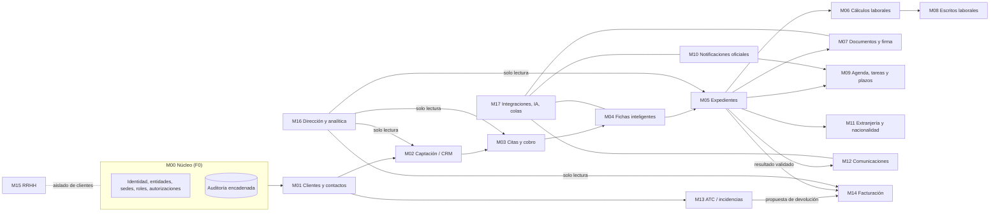
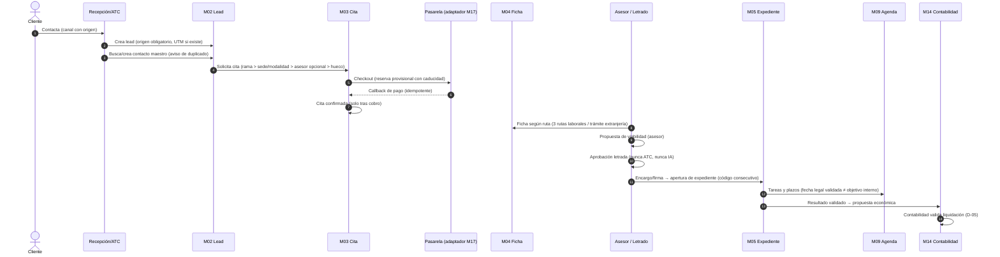
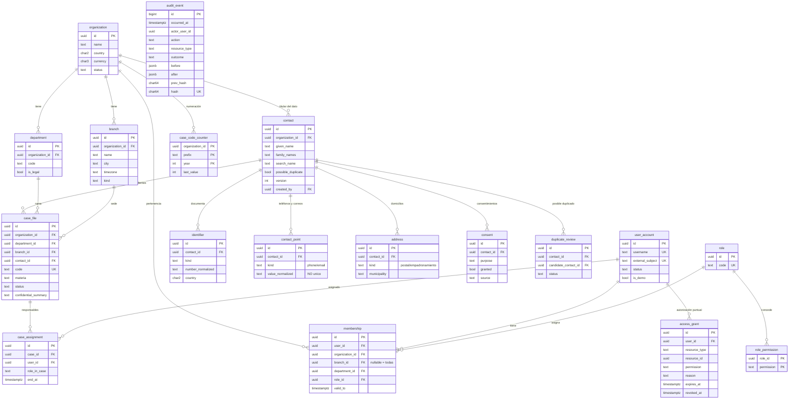
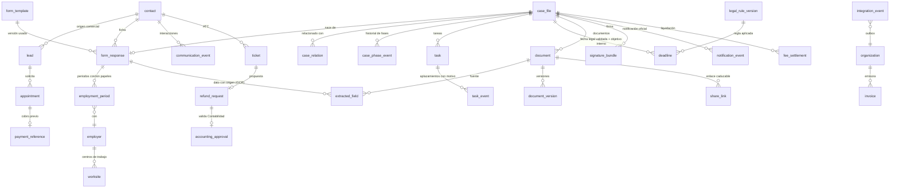

# Arquitectura funcional y modelo de datos

Versión de trabajo 02/11/2026 · Estado: **propuesta para validación de Dirección** (no aprobada).

## 1. Principio rector

Un **monolito modular**: una sola API, una sola base de datos PostgreSQL y un solo modelo de identidad, dividido
en módulos con fronteras explícitas (paquetes y tablas propias, comunicación por servicios internos y eventos de
dominio). Los 18 módulos de la matriz (M00–M17) son módulos de este monolito, no aplicaciones separadas. Se podrá
extraer un módulo a un servicio aparte solo cuando un dato medido lo justifique (carga de OCR, por ejemplo).

Por qué no microservicios ahora: 47 personas usuarias, un equipo técnico pequeño y una regla dominante —los
permisos se deciden con datos de varios módulos a la vez (entidad, sede, rama, asignación)— que en un sistema
distribuido obligaría a replicar la autorización en cada servicio. Ver ADR-0001.

## 2. Mapa de módulos y dependencias

Reglas de dependencia:
- Todos los módulos dependen de M00 para identidad, autorización y auditoría; **ninguno implementa su propio control de acceso**.
- M01 es la única fuente de la persona. Lead, cita, ficha, expediente, documento y factura **referencian** `contact.id`; nunca copian sus datos.
- M15 (RRHH) comparte identidad de empleados pero sus datos viven en tablas sin relación con clientes (AT-26).
- M16 solo lee; los KPI se calculan sobre los mismos registros operativos (AT-27), no sobre hojas paralelas.
- Todo proveedor externo (pasarela, WhatsApp, firma, OCR, IA, portales) entra por M17 mediante un adaptador con cola, reintentos e idempotencia.

## 3. Flujo de punta a punta (FL-01 → FL-08)

## 4. Modelo de datos

### 4.1 Implementado en F0.1 (migración `0001`)

Garantías en la propia base de datos (defensa en profundidad, no solo en la API):
- `audit_event`: triggers que rechazan UPDATE, DELETE y TRUNCATE; cadena SHA-256 verificable (`GET /audit-events/verify`).
- `case_file` y `contact`: trigger que impide el borrado físico (solo archivo lógico).
- `case_file`: trigger que impide mezclar contacto, sede o departamento de otra entidad.
- CHECK en materias, tipos de documento y tipos de contacto.
- Todas las fechas en `timestamptz` y sesiones de BD en UTC.

### 4.2 Modelo objetivo (se añade por incrementos, sin rehacer lo anterior)

Convenciones que todo módulo nuevo debe respetar:
1. PK `uuid` técnica irreversible + código visible configurable cuando el negocio lo necesite.
2. `organization_id` en toda tabla con datos de negocio; nunca se consulta sin filtrarlo por la política de M00.
3. Datos derivados de documentos o IA llevan **origen** (documento, página/segmento, confianza, extractor, validado_por, validado_en). Un dato sin validar no se usa en cálculos ni escritos.
4. Reglas legales y fiscales viven en `legal_rule_version` (fuente, vigencia, territorio, aprobador). El código ejecuta la versión aprobada; nunca contiene plazos fijos.
5. Cambios relevantes: evento en `audit_event` en la misma transacción.
6. Integraciones: patrón *outbox* (`integration_event` con `idempotency_key`) y un worker; los callbacks externos se deduplican por clave.

## 5. Capas técnicas

| Capa | Tecnología | Estado F0.1 |
|---|---|---|
| Web | Next.js 15 (App Router) + TypeScript, proxy same-origin a la API | Implementada |
| API | FastAPI + Pydantic v2, `/api/v1`, OpenAPI en `/api/v1/docs` | Implementada |
| Datos | PostgreSQL 16, SQLAlchemy 2, Alembic (migraciones reversibles) | Implementada |
| Identidad | OIDC + MFA (proveedor por decidir, T-01); modo DEMO solo en desarrollo | DEMO implementado; OIDC = "No disponible aún" |
| Documentos | Almacenamiento S3 compatible cifrado, URLs temporales, antivirus | F2 |
| Asíncrono | Cola (Redis o tabla outbox + worker) con reintentos e idempotencia | F1.3 (pagos) |
| Observabilidad | Logs estructurados con `request_id`, métricas, alertas | Parcial (request_id) |
