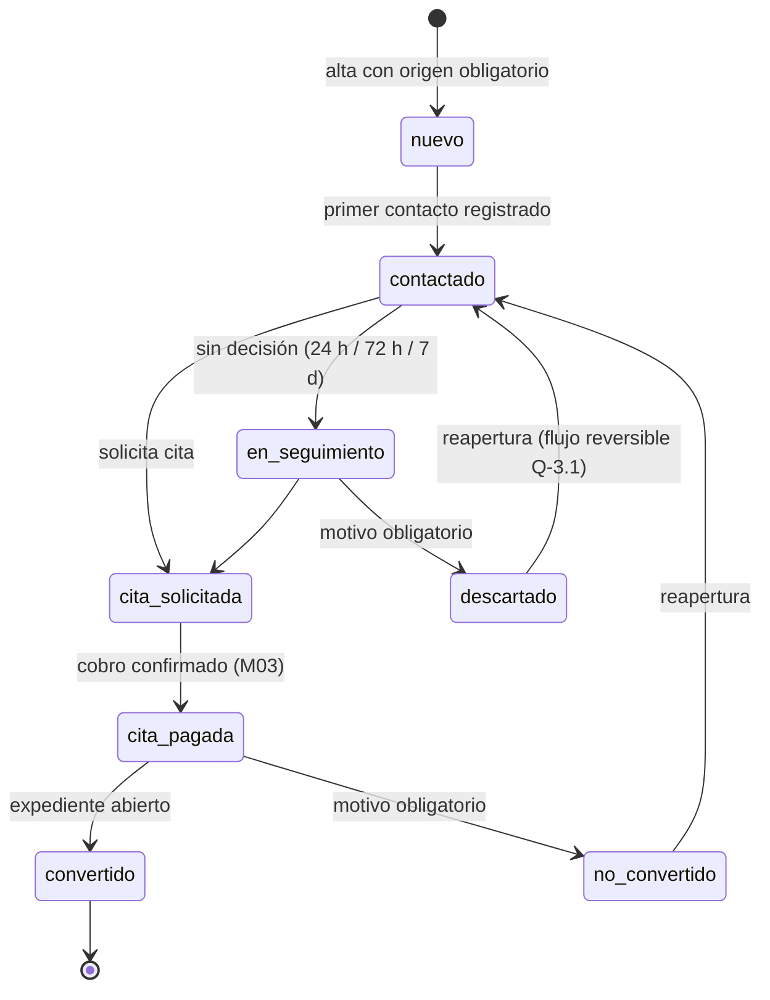
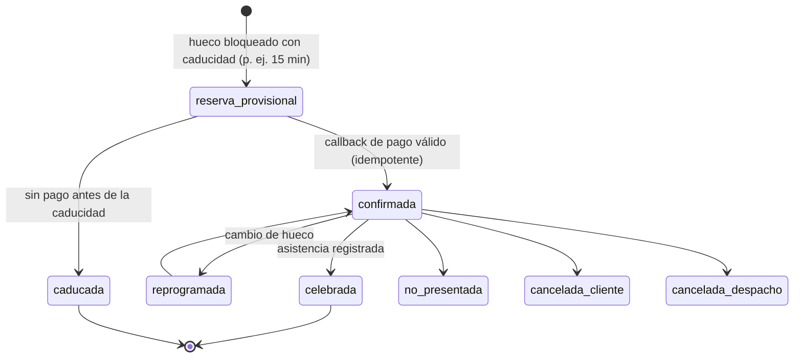
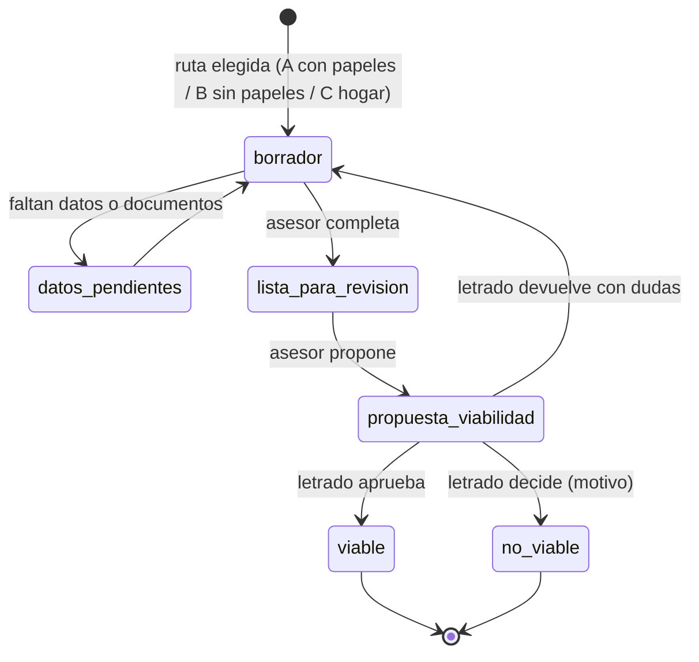
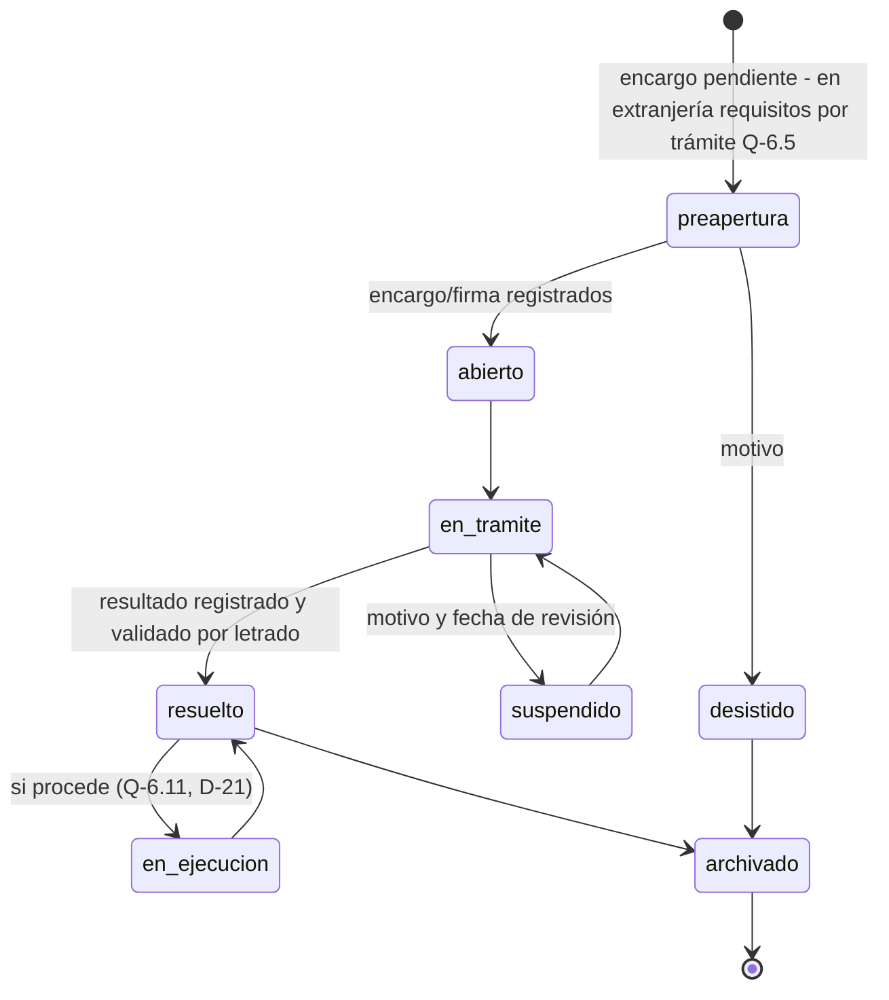
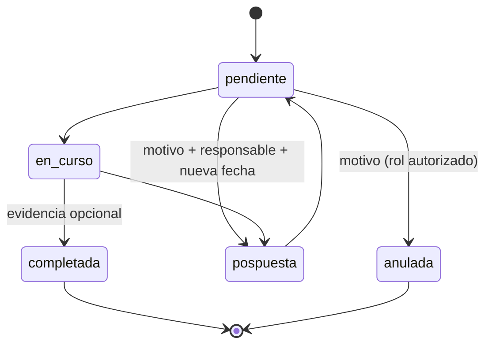
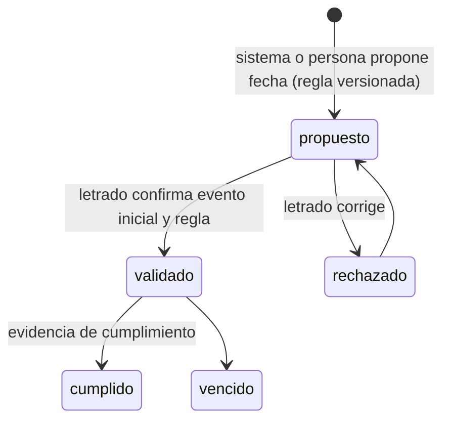
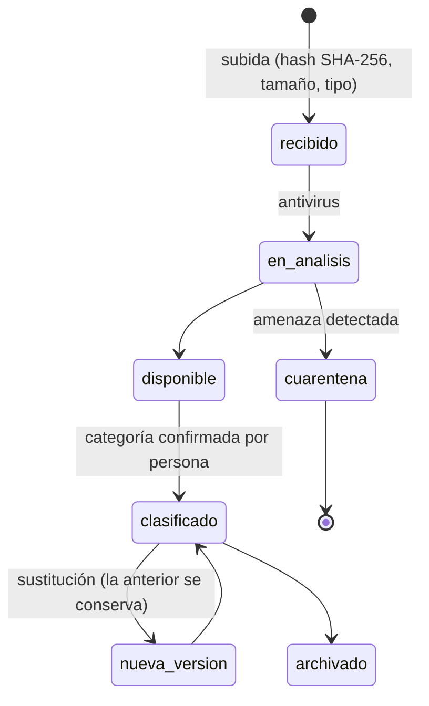
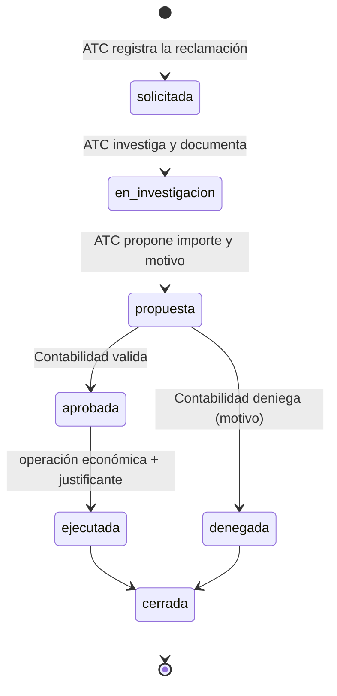

# Estados y transiciones

Reglas comunes a todas las máquinas de estado:
- Cada transición es un **evento** (`*_event`) con actor, fecha UTC, estado anterior, estado nuevo y motivo cuando aplica; nunca se sobrescribe el historial.
- El backend comprueba **quién** puede ejecutar cada transición (columna "Quién"). La interfaz solo muestra los botones permitidos, pero la API es la que decide.
- Ningún estado se borra. "Anulado", "archivado" o "descartado" son estados finales con motivo.
- La IA nunca ejecuta transiciones; como mucho propone y un humano confirma.

## 1. Lead (M02, F1.2) — Q-2.1, Q-2.7, Q-2.8, Q-3.1

| Transición | Quién | Condición |
|---|---|---|
| alta | Recepción, ATC, Marketing, asesores | `origen` obligatorio (AT-05); UTM si existe |
| → descartado / no_convertido | Asesor, Líder | motivo de catálogo |
| → convertido | Sistema | al abrirse un expediente vinculado (AT-06) |

## 2. Cita (M03, F1.3) — Q-2.4, Q-2.5, Q-2.6, Q-3.7, U-14

- AT-08: `caducada` libera el hueco; una cita sin pago **nunca** ocupa agenda permanente.
- AT-07: dos callbacks idénticos → una sola confirmación y un solo cobro (clave de idempotencia del proveedor).
- Modalidad: presencial o teléfono; videollamada solo como excepción autorizada (U-14 / D-11, pendiente de ratificar).
- Devoluciones de citas: siguen el flujo de devolución (§7), nunca se ejecutan desde la cita.

## 3. Evaluación / ficha (M04, F2) — Q-6.1, I-004, U-01…U-12

- ATC y Recepción no pueden ejecutar `→ viable / no_viable` (U-13). La IA no puede ejecutarlas (D-24).
- Datos extraídos por OCR permanecen "sin validar" hasta que el asesor los confirma (AT-11).
- Si consta papeleta previa u otro abogado (U-11), `lista_para_revision` exige marcar la revisión de ese hecho (AT-14).

## 4. Expediente (M05) — Q-6.2, Q-6.4, I-007…I-010

- En F0.1 existen `abierto` y `en_tramite` (datos de demostración). Las transiciones llegan en F2.1.
- Cambio de fase solo por rol designado; las tareas anteriores persisten (AT-16).
- Sin borrado físico (trigger en BD). La supresión por derechos RGPD se tramita como procedimiento con DPO, no como botón.
- Indicador de inactividad (Q-6.4): calculado desde el último evento, no un campo editable.

## 5. Tarea / plazo (M09, F2.2) — I-073, Q-6.9, Q-6.10, Q-6.20B, U-16

Plazo legal, separado de la tarea:

- AT-19: una fecha jurídica queda **pendiente** hasta su validación; objetivo interno y plazo legal se muestran por separado.
- AT-20: la tarea pospuesta conserva la fecha anterior en `task_event`.
- Q-6.23: nadie edita ni elimina tareas ajenas salvo rol autorizado (control en backend).

## 6. Documento (M07, F2.3) — I-078, Q-6.13, Q-6.14

- Descargas y enlaces caducables registrados (AT-32). Portal del cliente: solo su expediente (AT-17).

## 7. Devolución (M13 → M14, F4) — Q-3.9, Q-4.4, U-13

- AT-24: ATC **no** puede ejecutar `aprobada` ni `ejecutada`; solo Contabilidad, con comprobante adjunto.
- Separación de funciones: quien propone no puede aprobar la misma devolución.
